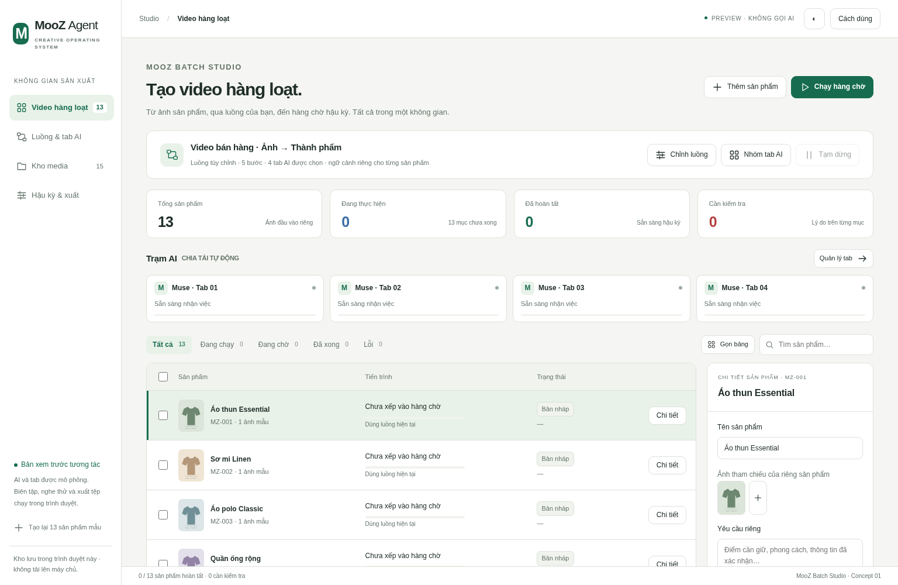
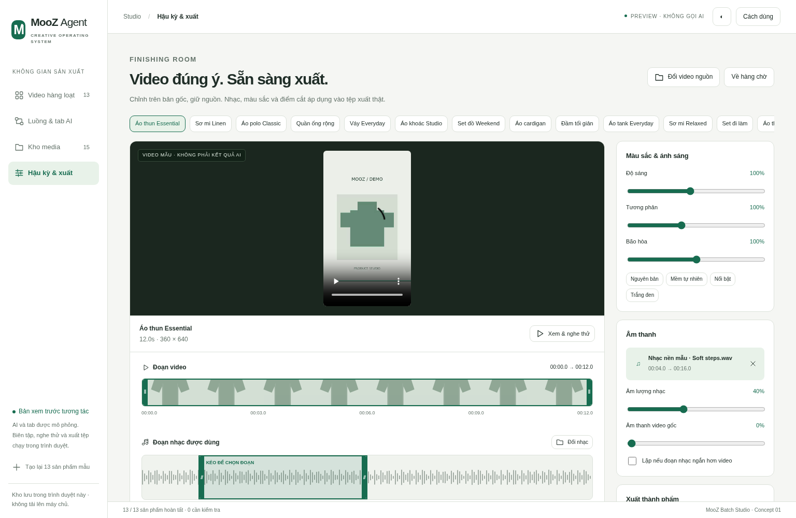

# Đề xuất giao diện Studio

Đây là bản mẫu để xem trước, **chưa áp dụng vào ứng dụng** và không đóng gói cùng app. Không gọi AI, không tạo dự án thật, không đăng bài, không đọc dữ liệu tài khoản. Các tên, số cảnh và trạng thái kết nối trong bản mẫu là dữ liệu minh họa.

Mở `studio-refresh-proposal.html` bằng trình duyệt: có thể chuyển Dự án / Quy trình / Đăng bài, đổi sáng tối, mở timeline và thu phần chi tiết. Các nút thao tác chỉ thông báo đây là bản mẫu.

- [Canvas](studio-refresh-canvas.png): giảm nút trên thanh chính, phân nhóm node bằng màu, chi tiết ở bên phải, timeline thu gọn.
- [Đăng bài](studio-refresh-posting.png): thành phẩm → Muse viết theo cài đặt → đăng; phần soạn content trước thu vào tùy chọn nâng cao để tránh nhầm hai đường.
- [Dự án](studio-refresh-home.png): danh sách gọn, tên và trạng thái rõ.

Bản 0.41.1 chỉ sửa chức năng Tổng hợp video và bố cục riêng node đó. Chưa thay toàn bộ giao diện bằng bản mẫu này.

## MooZ Batch Studio · video hàng loạt

Bản xem trước tương tác mới: [mở HTML tự chứa](mooz-batch-video-preview.html). Tải tệp này về rồi mở bằng Chrome, không cần server hay thư viện ngoài.

- Nhập/nhóm ảnh sản phẩm, luồng tùy chỉnh và nhóm tab AI theo từng bước.
- Mô phỏng 13 sản phẩm trên 4 tab, tạm dừng, lỗi riêng và chạy tiếp.
- Kho ảnh/MP3/MP4 có tải tệp, tìm/lọc, đổi tên và bỏ khỏi kho.
- Hậu kỳ có cắt video, kéo/cắt đoạn nhạc, âm lượng gốc/nhạc, màu sắc và xuất tệp thật.

AI/tab là mô phỏng và kết quả AI là clip mẫu. Chưa thay bản cài hiện tại. [Logic và phạm vi](../docs/BATCH-VIDEO-STUDIO-PLAN.md) · [Nguồn, cách tạo lại và kiểm thử](batch-video/README.md).

