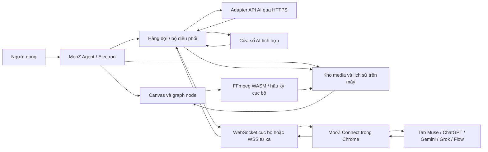
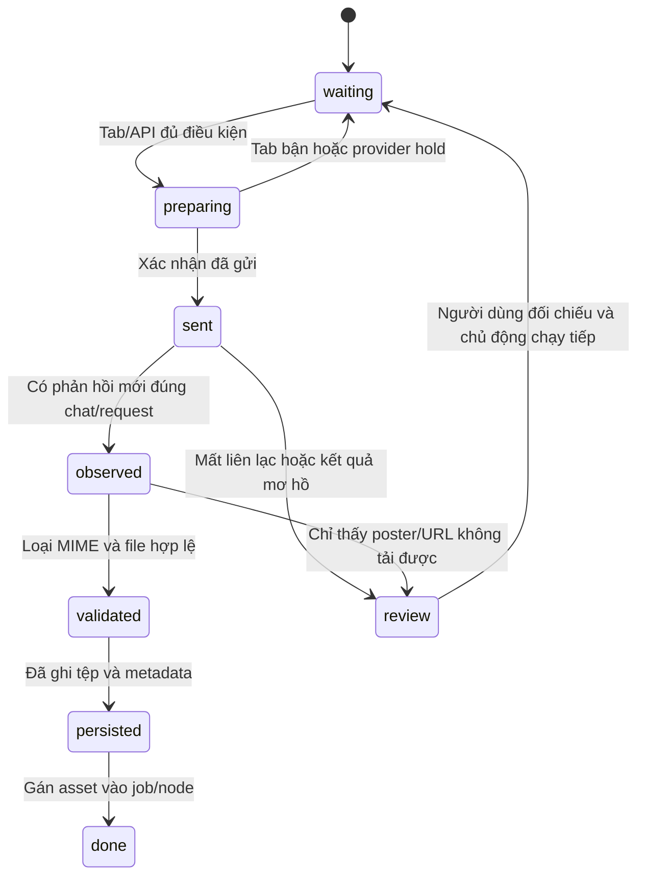
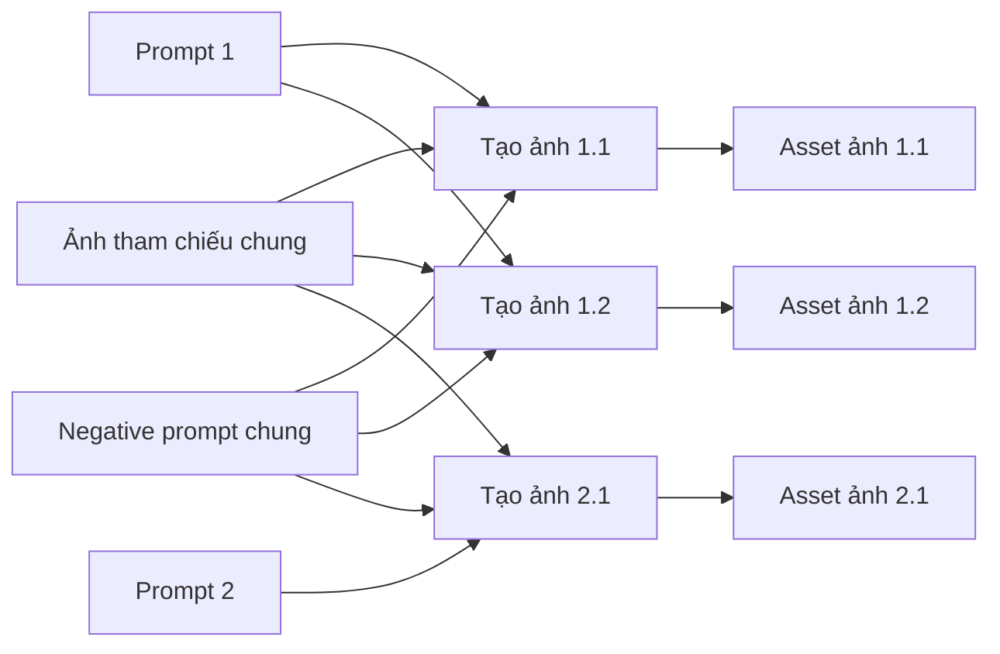
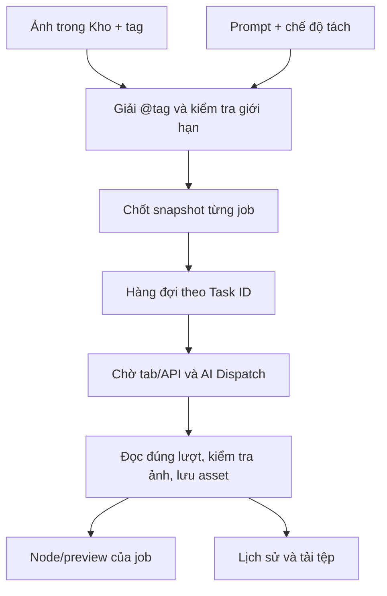
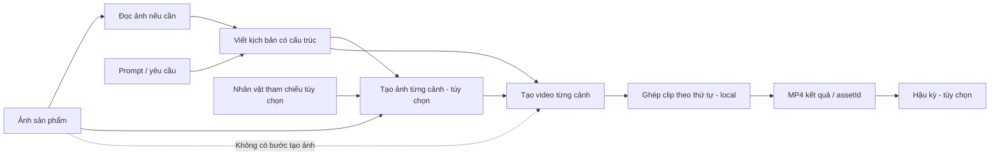
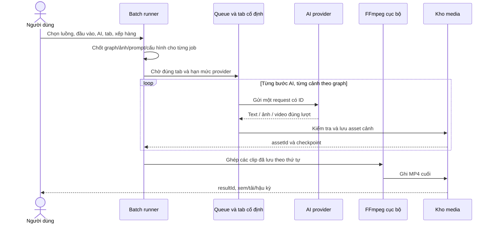
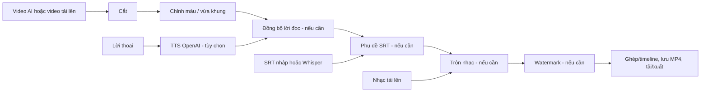
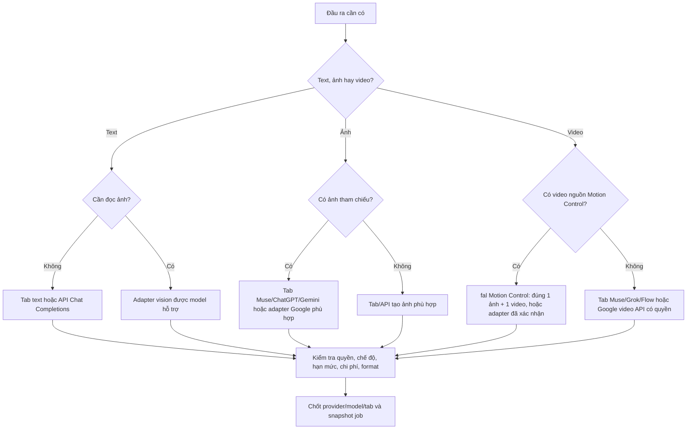

# Bàn giao kỹ thuật app-mooz: kết nối AI, tạo hàng loạt và hậu kỳ video

**Đối tượng:** đối tác cần hiểu, sử dụng hoặc xây ứng dụng tương tự MooZ Agent. **Nguồn đối chiếu:** repo `mktminhqpbga-glitch/app-mooz`, bản ứng dụng 0.69.0 và MooZ Connect 1.9.2, ngày 05/11/2026. Tài liệu này nói về **app Electron**, không phải website `mooz.gt.tc` hay bản Canvas web độc lập.

**Quy tắc thiết kế:** các sơ đồ dưới đây mô tả quan hệ dữ liệu, trạng thái và thao tác. Chúng **không quy định bố cục màn hình, vị trí nút, kích thước, màu hay thứ tự các bảng**. Khi xây giao diện, đối tác tự áp dụng hệ thống thiết kế chung của app và kiểm tra khả năng sử dụng thực tế.

## 1. Bản đồ hệ thống



**Năm lớp phải tách riêng:** (1) graph mô tả đầu vào, xử lý, đầu ra; (2) queue quyết định khi nào chạy, giữ snapshot và tab; (3) transport chuyển thông điệp; (4) website/API AI thực sự suy luận; (5) kho media lưu tệp trả về. WebSocket kết nối được **chưa có nghĩa** tab đã đăng nhập, model đúng, có quyền tạo media, hoặc kết quả đã được lưu.

**Thuật ngữ:** *provider* là Muse/Google/OpenAI…; *model* là lựa chọn trong website hoặc API; *tab* là phiên trình duyệt cụ thể; *requestId* đánh dấu một lượt gửi; *job* là một tác vụ người dùng xếp hàng; *asset* là tệp ảnh/video/âm thanh đã lưu; *checkpoint* là tiến trình đã ghi để tiếp tục từ phần chưa xong. `Ảnh trống → prompt → ảnh kết quả` là một chuỗi dữ liệu; nhìn thấy preview không đồng nghĩa có asset bền vững.

## 2. Kết nối AI gồm những gì và giao thức là gì?

### 2.1 Bốn con đường hiện có

| Kênh | Cần cài/chọn | Giao thức thực tế | Dùng cho | Giới hạn quan trọng |
| --- | --- | --- | --- | --- |
| Tab AI cùng máy | App, Chrome/Edge, MooZ Connect, tab đã đăng nhập | WebSocket `ws://127.0.0.1:<cổng>` giữa app và extension; extension thao tác DOM trang AI | Muse, ChatGPT, Gemini, Grok, Flow theo adapter | Không có API chính thức của website; UI trang đổi có thể làm bridge lỗi. |
| Tab AI máy khác | Như trên, cộng relay Internet | WebSocket Secure `wss://` tới broker; payload app↔extension mã hóa đầu cuối | Các tab mà MooZ Connect hỗ trợ | Broker chỉ chuyển dữ liệu, giữ phòng trong RAM, không chạy AI hay giữ job bền vững. |
| Cửa sổ AI trong app | Cửa sổ website do Electron mở, đăng nhập khi website cho phép | IPC/native window bridge do app quản lý | Một số tác vụ tab AI | Website có thể từ chối đăng nhập trong cửa sổ tích hợp. |
| API trực tiếp | API key, model, quyền sử dụng, mạng | HTTPS request/response theo adapter cụ thể; có API bất đồng bộ cần thăm dò | Google, OpenAI, fal; API tùy chỉnh cho văn bản | Có phí/hạn mức; API tùy chỉnh kiểu Chat Completions không tạo ảnh/video. |

**WebSocket là gì?** Một kết nối hai chiều tồn tại liên tục. App có thể gửi lệnh `kiểm tra tab`, `chuẩn bị`, `gửi`, `đọc trạng thái`; extension có thể trả phản hồi/progress mà không phải mở HTTP request mới cho từng sự kiện. `ws://127.0.0.1` chỉ đi trên chính máy; `wss://` là WebSocket trên TLS khi đi qua Internet. **HTTPS API** khác ở chỗ app gửi POST trực tiếp tới dịch vụ AI, xác thực bằng API key, nhận JSON/URL/tác vụ bất đồng bộ rồi parse theo provider. **IPC** là trao đổi giữa tiến trình Electron, không phải kết nối mạng với Chrome.

**Mã `workflow-connect://...` là gì?** Đây là *mã ghép*, không phải URL của model hay API key. Nó mang endpoint, token/room/invite để app và MooZ Connect xác thực phiên. Với kết nối local, app mở cổng ngẫu nhiên trên `127.0.0.1`; extension mở socket rồi gửi `auth`, app kiểm tra token/origin và đáp `ready` với phiên bản giao thức. Mã local có thể không còn đúng sau khi app khởi động lại. Mã remote chứa endpoint WSS và thông tin vào phòng; mã mời chưa dùng có hạn khoảng 10 phút. Mã cũ đã hết hạn cần tạo lại trong app, **không** sửa chuỗi `expires` bằng tay. Mã ghép là bí mật phiên, không dán vào tài liệu hay chat công khai.

**Relay hoạt động ra sao?** App và Chrome cùng mở kết nối đi ra broker `relay-server/`; broker ghép phòng và chuyển gói. `chrome-relay-channel.js` mã hóa đầu cuối bằng AES-256-GCM, kiểm tra phiên/hướng/thứ tự; dữ liệu lớn chia thành khung khoảng 192 KiB và thông điệp JSON tối đa 128 MB. `/health` trả 200 chỉ chứng minh HTTP server sống; cần kiểm tra riêng WSS, vào phòng, xác thực app và trạng thái tab. Nếu app và Chrome cùng máy, ưu tiên local vì không phụ thuộc broker. Khi khác máy, mạng/VPN ổn định hoặc relay WSS mới có ý nghĩa; transport tốt vẫn không ép website AI chạy khi tab bị ngủ/discard.

### 2.2 Provider và khả năng mà bộ nối khai báo

| Provider | Kênh | Văn bản | Ảnh | Video | Cần chú ý |
| --- | --- | :---: | :---: | :---: | --- |
| Muse | Tab | Có | Có | Có | Giữ đúng chat và chế độ Ảnh/Video. |
| ChatGPT | Tab | Có | Có | Không khai báo | Kết quả phụ thuộc gói và UI tài khoản. |
| Gemini | Tab | Có | Có | Không khai báo | Không suy diễn Gemini tab là Veo API. |
| Grok | Tab | Có | Có | Có | Chọn Chat/Imagine và chế độ đúng trên trang. |
| Google Flow/Veo | Tab | Không | Có | Có | Mở đúng project, model và chế độ của Flow. |
| Google | API | Có | Có | Có | Veo/model phải còn quyền; adapter video kiểm tra giới hạn riêng. |
| OpenAI | API | Có | Có | Không khai báo | Adapter ảnh hiện không nhận ảnh tham chiếu. |
| fal.ai | API | Không | Không | Có | Motion Control cần đúng một ảnh và một video nguồn. |
| API tùy chỉnh | API | Có; có thể đọc ảnh | Không | Không | Chuẩn OpenAI Chat Completions; bật vision chỉ khi model hỗ trợ. |

Đây là **năng lực adapter**, không phải lời hứa model/tài khoản nào cũng dùng được. Website tab dùng **model đang chọn trong tab**, app không tự đổi model cho từng node. Với API, model được cấu hình trong app và kiểm tra quyền thực tế trước khi chạy. Veo qua Flow là tab website; Veo qua Google API là con đường khác, khóa/quyền/giới hạn khác.

### 2.3 Cài đặt và chọn đường kết nối

1. **Đường tab:** cài MooZ Agent và MooZ Connect tương thích từ gói app. Giải nén extension, Chrome `chrome://extensions` → bật Developer mode → Load unpacked thư mục có `manifest.json`. Khi cập nhật extension, tải lại extension **và các tab AI** để content script mới hoạt động; gỡ bản extension trùng nếu có.
2. Mở app, chọn kết nối Chrome local hoặc remote, tạo mã ghép và dán vào popup MooZ Connect. Kiểm tra cả hai phía báo xác thực thành công. Mở tab website được hỗ trợ, đăng nhập, vào đúng chat/project, chọn chế độ/model cần thiết trong chính trang đó.
3. Làm mới danh sách tab trong app. Đọc provider, URL, thiết bị, tab, tình trạng composer/đăng nhập/bận. Chỉ tab đã xác nhận sẵn sàng mới dùng để chạy. Với luồng video hàng loạt, chọn **AI cho cả luồng**, rồi chọn **một tab cho cả tác vụ** khi nhập đầu vào; nếu chọn tự động, app lấy một tab phù hợp lúc rảnh.
4. **Đường API tích hợp:** nhập key Google/OpenAI/fal trong thiết lập AI, chọn adapter/model và loại đầu ra phù hợp. Không cần Chrome. OpenAI TTS/Whisper trong hậu kỳ cũng cần khóa OpenAI và có thể tính phí.
5. **API tùy chỉnh:** nhập tên, HTTPS base URL công khai, model, API key; endpoint theo chuẩn `/chat/completions`. Chỉ bật đọc ảnh khi model hỗ trợ `image_url`. Không dùng cấu hình này để chờ image/video output. Tên/model/URL nằm trong cấu hình local; key chỉ ở bộ nhớ phiên app và phải nhập lại sau khi mở app. Không cho token nằm trong URL/query.

### 2.4 Trình tự một lượt gửi qua tab AI

```mermaid
sequenceDiagram
  actor U as Người dùng
  participant Q as Queue / AIDispatch
  participant T as WebSocket / WSS
  participant E as MooZ Connect
  participant W as Tab website AI
  participant S as Kho media
  U->>Q: Xếp job với snapshot đầu vào, AI, tab
  Q->>Q: Đăng ký requestId; chờ giới hạn provider/tab
  Q->>T: prepare: kiểm tra phiên và xin lượt trước upload
  T->>E: Lệnh đúng deviceId/tabId
  E->>W: Kiểm tra chat, mode, composer; gắn tệp
  W-->>E: Attachment hiển thị, sẵn sàng gửi
  E->>Q: permit: xin quyền ngay trước thao tác gửi
  Q-->>E: Cho phép ngắn hạn
  E->>W: Nhập prompt và gửi đúng một lần
  E-->>Q: sent + requestId
  loop Thăm dò trạng thái, không gửi lại prompt
    Q->>E: status(requestId)
    E->>W: Chỉ đọc phản hồi mới của đúng chat
    E-->>Q: progress / result / error
  end
  Q->>S: Kiểm tra loại, tải bytes, ghi asset
  S-->>Q: assetId và metadata đã lưu
  Q-->>E: ACK phản hồi đã nhận
  Q-->>U: Thành phẩm hoặc trạng thái cần đối chiếu
```

`desktop/ai-dispatch.cjs` điều phối `register → prepare → permit → sent → finish`. Mặc định mỗi provider một request hoạt động, cách nhau ít nhất 5 giây và có cooldown 5 giây; giới hạn có thể cấu hình trong phạm vi code. Mỗi tab chỉ một job; hai tab có thể giữ hai job nhưng **không tự vượt** hạn mức provider. Quyền `permit` chỉ hiệu lực ngắn (khoảng 2 giây). Tab bận thì job chờ; tab chỉ định A bận thì chờ A dù B rảnh. Luồng video đã gán tab nào giữ tab đó xuyên suốt các bước AI và bước local, tránh trộn chat/nhân vật.

`MUSEFLOW_JOB_START` là thao tác có thể gửi prompt/tính lượt; `MUSEFLOW_JOB_STATUS` chỉ đọc cùng `requestId` (mặc định hỏi khoảng mỗi 10 giây); `MUSEFLOW_JOB_ACK` dọn job đã đọc trong tab. `response-ack` là ACK ở tầng WebSocket cho phản hồi extension. Hai ACK này **không chứng minh tệp đã lưu vào kho media**. Sau đứt socket ngắn, app/extension có thể nối lại và giữ phản hồi khoảng 90 giây trên một số mã đóng; không phát một `START` mới để “thử lại” khi chưa rõ website đã nhận prompt chưa.

### 2.5 Đọc kết quả, nhận diện đúng lượt và lưu



**Trước gửi**, bridge chụp baseline URL/DOM của media đã có, ảnh tham chiếu được upload, URL chat và trạng thái đang soạn. **Sau gửi**, chỉ đọc phản hồi trợ lý mới của đúng chat và đúng request; loại ảnh user/avatar, tệp tham chiếu, media lịch sử, đoạn văn bản còn streaming. Ảnh upload có thể xuất hiện lại với URL CDN mới, nên phải so fingerprint/nội dung chứ không chỉ so URL. Nếu chat đổi, không lấy kết quả từ chat mới. Nếu có hai kết quả mới không phân biệt được, đưa job vào trạng thái cần đối chiếu.

| Loại | Nhận thế nào | Trước khi ghi thành phẩm |
| --- | --- | --- |
| Text | Phản hồi mới ổn định; cắt marker nếu có | Không rỗng; nếu là kịch bản nhiều cảnh, parse JSON và kiểm tra đủ cảnh/thứ tự/trường. |
| Image | Ảnh mới từ phản hồi hiện tại; tải bytes thành Blob/data URL | MIME `image/*`, giải mã/kích thước được, không trùng ảnh đầu vào. |
| Video | Video mới và **file media thật**; tải bytes, thăm dò metadata | MIME `video/*`, thời lượng/kích thước >0, trong giới hạn dung lượng; poster/MSE preview không đạt. |
| API | Parse schema/operation riêng của adapter, lấy bytes từ URL nếu cần | HTTP thành công, model/quyền đúng, URL an toàn, media đúng loại và đọc được. |

Trong Canvas, kết quả AI được gán vào `node.data.asset` rồi truyền cho preview qua edge; graph được lưu với Blob cục bộ trong IndexedDB `museflow-media` và khóa `museflow-idb:<key>` khi chuyển đổi được. Có trường hợp Canvas thấy URL ngoài nhưng không tải/lưu được; phải thể hiện `đã thấy trên AI, chưa lưu an toàn`, không gọi đó là thành phẩm bền vững. Trong Video hàng loạt, `desktop/batch-ai.cjs` yêu cầu media đã copy về thành `data:image/...` hoặc `data:video/...`; runner đổi thành Blob, `saveResult` từ chối rỗng/quá 100 MB, ghi asset ID, rồi lưu ID trong `job.outputs[stepId].items`. Bước cuối có `resultId`; chỉ khi asset cuối tồn tại mới coi job hoàn tất. Từng cảnh có asset riêng và checkpoint; retry phần chưa hoàn tất phải giữ kết quả đã lưu.

**Hợp đồng đề xuất cho đối tác (không phải public JSON API hiện tại):** `jobId`, `stepId`, `nodeId`, `requestId`, `provider`, `model`, `transport`, `deviceId`, `tabId`, `conversationIdentity`, `sentAt`, `observedAt`, `validatedAt`, `persistedAt`, `assetId`, `kind`, `mime`, `bytes`, `width`, `height`, `duration`, `storageKey`, `sourceFingerprint`, `status`, `errorCode`. Ghi asset trước, ghi mapping job/node sau, rồi mới báo `done`. Xử lý phản hồi trùng theo `requestId + fingerprint` để không tạo hai asset; không log key, cookie, token ghép hoặc prompt nhạy cảm. Đây là mức hoàn thiện **nên triển khai**, không khẳng định mọi nhánh Canvas hiện có đã đạt transaction như vậy.

**Khi lỗi:** phân biệt `chưa gửi` (có thể đợi/sửa cấu hình), `đã gửi nhưng chưa rõ` (kiểm tra tab/lịch sử; không tự gửi lại), `đã thấy nhưng không tải được` (tải/nhập tệp thủ công), `đã tải nhưng không lưu được` (giữ lỗi lưu, không đánh dấu done). App khởi động lại giữa lúc Video hàng loạt đang `running` chuyển job sang lỗi/cần kiểm tra tab, không tự gửi lại. Thông báo “Cuộc trò chuyện Muse đã đổi” là lỗi danh tính chat, không tự chứng minh relay hỏng.

## 3. Tạo ảnh hàng loạt: chọn gì, chạy qua đâu, ra kết quả gì?

MooZ có **hai đường chính** tạo ảnh nhiều tác vụ. Chúng cùng dùng adapter AI và nguyên tắc nhận kết quả, nhưng giao diện/queue khác nhau; đối tác nên hợp nhất trải nghiệm mà không làm mất contract dữ liệu.

### 3.1 Đường A — tạo nhiều node ảnh trên Canvas

1. Chuẩn bị prompt: mỗi dòng là một prompt; nếu có dòng trống phân cách thì mỗi **đoạn** cách nhau bởi dòng trống là một prompt, có thể dài nhiều dòng. Chọn số bản sao **1–10** cho mỗi prompt. Tổng `số prompt × số bản sao ≤ 50` trong một đợt.
2. Chọn provider tạo ảnh: Muse/ChatGPT/Gemini **tab**, hoặc Google/OpenAI **API**, theo lựa chọn đang có trong bộ chọn. Chọn tỷ lệ `16:9`, `9:16`, `1:1`, `4:3`, `3:4`. Chọn model trên website tab trước khi gửi; API dùng model/khóa đã cấu hình. Tỷ lệ gửi là yêu cầu, kết quả thực tế phụ thuộc dịch vụ.
3. Có thể nhập negative prompt chung và thêm tối đa **8 ảnh tham chiếu chung**, tổng tối đa **20 MB**. Tệp phải là ảnh đọc được, mỗi tệp ≤20 MB. Adapter OpenAI tạo ảnh ở bản này **không nhận ảnh tham chiếu**, nên phải đổi provider hoặc bỏ ảnh. Ảnh tham chiếu chung không tự gắn vào node cũ.
4. Chọn **Tạo node ảnh** để chỉ dựng graph. Chọn **Tạo node và chọn chạy** để dựng graph rồi mở danh sách chọn/thứ tự chạy; cần xác nhận chạy thì AI mới được gửi. Không coi lúc xuất hiện node là lúc đã tạo xong ảnh.
5. Với mỗi prompt/bản sao, app tạo node `prompt` nối vào `generateImage`. Ảnh tham chiếu và negative prompt chung được nối vào từng node ảnh. Runner đọc chính các edge liên quan, chờ tab/dispatch, gửi, đọc kết quả mới, kiểm tra asset, rồi gán preview ảnh. Lỗi từng ảnh phải giữ prompt và đầu vào để người dùng kiểm tra/chạy lại có chủ đích.



Ví dụ: 3 prompt, 2 bản sao → 6 node tạo ảnh/6 lượt kết quả. “Bản sao” là **sáu lần tạo độc lập**, không phải nhân bản cùng một tệp ảnh. Mỗi result gắn đúng node/request và có thể đưa tiếp sang node video/hậu kỳ theo edge.

### 3.2 Đường B — Hàng đợi · Kho ảnh / Flow Studio

1. Thêm ảnh PNG/JPG/WebP vào kho, tối đa **8 MB mỗi ảnh**; tag được tạo từ tên và có thể sửa. Trong prompt dùng `@tag` để tham chiếu ảnh. Một job tối đa **8 ảnh**, tổng dữ liệu ảnh snapshot trong kho/hàng đợi giới hạn **32 MB**. Tag chưa tồn tại chặn cả đợt trước khi xếp.
2. Tách prompt bằng khối `[ ... ]` (mặc định, cho phép nhiều dòng), hoặc mỗi dòng, mỗi đoạn cách dòng trống, hoặc gộp toàn văn thành một job. Mỗi đợt tối đa **50 prompt**, mỗi prompt tối đa **20.000 ký tự**, danh sách tối đa **200 job**. Chọn AI, chat/tab, tỷ lệ và thời lượng khi loại job cần video; kiểm tra khả năng provider.
3. **Thêm & tạo node** tạo nhóm node và chốt prompt/ảnh/thiết lập/chat thành snapshot, chưa tự gửi AI. **Chạy hàng đợi** bắt đầu cấp việc. Có thể đặt 1–6 tác vụ song song toàn queue (mặc định 1), nhưng **mỗi tab một việc** và giới hạn provider/nhịp gửi vẫn áp dụng. Muốn song song thực, phải có nhiều tab thích hợp và cấu hình provider cho phép.
4. Mỗi dòng có Task ID, trạng thái, prompt snapshot, đầu vào, lỗi và kết quả đúng lượt; xem/tải ảnh từ asset của chính Task ID. Đổi tag hoặc xóa ảnh gốc khỏi kho sau khi xếp không đổi ảnh đã chốt. Nếu tải lại app/trang lúc job đang chạy, job thành **Cần kiểm tra**, không tự gửi lại. Hàng đợi lưu cục bộ trong hồ sơ, không đồng bộ nhiều máy; chỉ một trang quản lý queue có Web Lock.



**Lưu ý khi xây app mới:** giữ hai thao tác riêng `tạo kế hoạch/node` và `thực sự gửi AI`; hiển thị số job, số đang chạy, lý do chờ, số hoàn thành/lỗi/cần kiểm tra. Không dùng một con số phần trăm giả khi provider chỉ trả trạng thái chung. Kết quả của job cũ không bị thay bằng media mới khi người dùng tạo lại từ cùng một thẻ.

## 4. Tạo video hàng loạt: từ đầu vào đến MP4

### 4.1 Chuẩn bị đầu vào và luồng

Có thể nhập **văn bản** (mỗi dòng một video hoặc gộp nhiều dòng thành một yêu cầu) hoặc tạo **sản phẩm từ ảnh** (mỗi ảnh là một sản phẩm hoặc nhiều ảnh chung một sản phẩm). Mỗi sản phẩm có tên/yêu cầu riêng; bản nháp có thể sửa trước khi xếp. Ở form chạy, chọn luồng đã lưu hoặc tạo graph, số cảnh 1–12, tỷ lệ, thời lượng yêu cầu mỗi cảnh và **một AI cho cả luồng**. Graph video hàng loạt hiện chọn các provider **tab** mà tất cả bước AI cùng hỗ trợ; với bước video, thực tế là Muse/Grok/Google Flow theo khả năng adapter. Google/fal **API video** là adapter ở các đường tác vụ khác, không phải lựa chọn thay thế trực tiếp trong bộ chọn AI của graph này. Chọn một tab chạy cả job hoặc tự chọn một tab phù hợp. Nếu chọn tab A mà A bận, job chờ A. Hai tab bận thì job tiếp theo chờ; không tách một job sang hai tab.

Graph `mooz-flow-plan-v1` có đầu vào A/B/C (ảnh, văn bản, video, âm thanh; bắt buộc hoặc tùy chọn), bước xử lý AI/local, kết quả Z. Dây nối có **kiểu dữ liệu**, runner chỉ lấy nguồn thực sự nối vào cổng. Graph có giới hạn khoảng **40 node, 120 dây, 12 cảnh**. Tên/bố cục node không tạo ra dữ liệu; edge và port mới xác định đường truyền. Luồng hai cảnh trở lên cần bước viết kịch bản; luồng một cảnh có thể đi trực tiếp tới tạo video rồi ghép. Bước tạo ảnh trước video là tùy chọn: nếu có, video dùng ảnh cảnh đã tạo; nếu không, dùng ảnh gốc/tham chiếu hợp lệ.



**Kịch bản nhiều cảnh** cần JSON có đúng số cảnh liên tiếp, `title`, `voiceover`, `imagePrompt`, `videoPrompt`, thời lượng/tỷ lệ khi cần. Bước ảnh chỉ dùng `imagePrompt` của cảnh tương ứng; bước video dùng `videoPrompt` và lời thoại đúng cảnh. Không đưa toàn bộ kịch bản lẫn prompt video vào lượt tạo ảnh. `voiceover` là nội dung chỉ dẫn, **không bảo đảm** file có giọng đọc hoặc lip-sync; muốn tiếng nói chắc chắn phải tạo/thêm track ở hậu kỳ.

### 4.2 Trình tự chạy và kết quả



Khi xếp hàng, app **chốt** ảnh, tên, prompt, graph/version, provider, tab preference, tỷ lệ/thời lượng. Thay bản nháp sau đó không thay job cũ. Runner đợi tài nguyên; chạy từng node theo thứ tự topo; với mỗi cảnh chỉ chuyển ảnh/nhân vật/video nguồn mà port đó nhận (tối đa **8 ảnh tham chiếu trong một lượt AI** ở flow runner, video nguồn tùy adapter). Kết quả text được giữ dưới dạng raw/parsed; ảnh/video phải được tải và lưu thành asset trước khi đi tiếp. `job.outputs[stepId].items` giữ asset theo từng cảnh. Bước ghép trên máy chỉ chạy khi có đủ clip thật, không dùng poster. Bước Z có `resultId`; lịch sử mở lại được asset, xem/tải MP4 và chuyển sang hậu kỳ.

Thời lượng 5/10/15/30/40 giây trong UI là **yêu cầu**; thời lượng thực do dịch vụ trả về, và adapter API có giới hạn riêng. Nếu chọn “Không chọn”, runner không nhét số giây giả vào prompt. Google Veo adapter có thể chỉ cho một ảnh mở đầu và một số mức duration riêng; fal Motion Control yêu cầu đúng một ảnh + một video nguồn. Nếu nhà cung cấp không hỗ trợ input đó, phải chặn trước khi gửi. Video có thể giữ frame cuối để làm tham chiếu cảnh sau, nhưng trích frame thất bại không được dùng frame giả.

**Ví dụ thao tác:** chuẩn bị 3 ảnh sản phẩm và yêu cầu chung “quay cận sản phẩm, nền studio”; chọn luồng 2 cảnh có `đọc ảnh → viết kịch bản → tạo video cảnh 1,2 → ghép`; chọn Muse và tab Muse A, tỷ lệ 9:16, yêu cầu 10 giây/cảnh; xếp 3 sản phẩm thành 3 job. Job 1 giữ A qua cả hai cảnh và ghép. Job 2/3 chờ A hoặc dùng tab khác **chỉ khi ban đầu chọn tự động và được gán tab phù hợp**; không chuyển giữa chừng. Mỗi job có 2 clip cảnh đã lưu và một MP4 cuối riêng. Nếu kịch bản sai JSON, dừng trước lượt tạo video; giữ câu trả lời thô để sửa/kiểm tra và chạy tiếp mà không gửi lại bước đã chấp nhận.

**Dừng/lỗi/khôi phục:** tạm dừng chỉ ngừng cấp việc mới; request đã gửi phải chờ hoặc thành `cần đối chiếu`. Nếu tab đổi chat, mất login, provider xác minh/429 hoặc relay rớt, hiện nguyên nhân và giữ tab của job. Không tự failover sang tab khác. Sau restart, job `running` không tự gửi lại; những asset/checkpoint đã lưu vẫn có. Người dùng kiểm tra tab/lịch sử AI trước khi retry phần còn thiếu. Dọn hàng đợi hoàn thành không đồng nghĩa xóa tệp lịch sử.

## 5. Hậu kỳ video: công cụ, cách nối và cách dùng

Hậu kỳ nhận **video đầu vào**, MP4 tạo bởi AI hoặc video từ bước hậu kỳ trước. Phần lớn thao tác dùng **FFmpeg WASM cục bộ**, mã hóa lại tệp mới và giữ nguồn cũ. Chỉ chọn TTS/Whisper mới gửi văn bản hoặc audio/video tới OpenAI; các công cụ cắt/màu/ghép/nhạc/phụ đề SRT có sẵn xử lý trên máy. Không giả định hậu kỳ biến video chất lượng thấp thành chi tiết thật; xuất H.264/AAC, hiệu ứng thường giới hạn cạnh dài 1280 và 24 fps.

| Công cụ/node | Đầu vào cần chọn | Thiết lập quan trọng | Kết quả |
| --- | --- | --- | --- |
| Cắt video | Một video | Bắt đầu/kết thúc tính giây; kết thúc 0 = đến hết, đoạn tối thiểu 0,05 giây | MP4 đoạn đã cắt. |
| Xoay/lật | Một video | Góc 0/90/180/270; lật ngang tùy chọn | MP4 đổi chiều hình; âm thanh giữ. |
| Chỉnh màu | Một video | Sáng −0,5…0,5; tương phản 0,1…3; bão hòa 0…3 | MP4 đã chỉnh màu; 0 saturation thành trắng đen. |
| Vừa khung | Một video | Tỷ lệ/khung đích | MP4 giữ tỷ lệ bằng padding nếu cần, không kéo giãn chủ thể. |
| Tách âm thanh | Video có track âm thanh | Không cần model AI | MP3 cho tải hoặc nối sang node âm thanh. |
| Âm thanh/nhạc nền | Video + MP3/WAV/M4A | Âm lượng gốc/nhạc 0–2; tắt âm gốc, lặp nhạc tùy chọn | MP4 có track trộn; nhạc ngắn có thể thêm im lặng khi không lặp. |
| Phụ đề | Video + SRT nhập/tệp hoặc text SRT | Timeline SRT hợp lệ, không chồng/vượt thời lượng; cỡ chữ 10–80 | MP4 burn-in phụ đề, có thể tải SRT riêng. |
| Nhận diện phụ đề | Video/audio chưa có SRT | OpenAI Whisper API, key có quyền, tệp ≤25 MB | SRT để sửa và đưa vào node phụ đề; có thể tính phí. |
| Lồng tiếng | Văn bản hoặc lời đọc | OpenAI `gpt-4o-mini-tts`, giọng/tốc độ, tối đa 4096 ký tự | MP3 giọng đọc AI; không phải clone giọng cá nhân. |
| Đồng bộ lời đọc–cảnh | Nhiều video cảnh + một/nhiều MP3 đọc | Một MP3 chung chia theo trọng số lời thoại hoặc đều; một MP3/cảnh khớp từng cảnh; cắt/giữ frame cuối/đổi tốc độ | MP4 với lời đọc thay track gốc. Không phải căn từng từ tự động. |
| Chuyển cảnh | Hai clip theo thứ tự | Hòa hình/tan/quét/trượt, chồng 0,1–5 giây và ngắn hơn mỗi clip | MP4 chuyển cảnh; tổng thời lượng trừ đoạn chồng. |
| Điều chỉnh tốc độ | Một video | Hệ số 0,25–4 | MP4 đổi tốc độ hình và âm, cố giữ cao độ. |
| Watermark/logo | Video + ảnh logo | Vị trí/kích thước/độ mờ theo node hiện hành | MP4 có lớp logo. |
| Ghép/xuất cuối | Các clip theo thứ tự/timeline | Thứ tự cảnh, đoạn dùng, âm thanh cuối | MP4 thành phẩm mới; asset nguồn/trung gian vẫn giữ. |



**Cách thực hiện một video hoàn chỉnh:**

1. Chọn asset MP4 đã tạo hoặc tải từ máy. Kiểm tra file phát được, có thời lượng/kích thước, và chọn đúng bản thành phẩm thay vì poster hay node trung gian.
2. Nối/cấp dữ liệu cho các công cụ cần dùng theo đúng cổng `Video`, `Audio`, `Text/SRT`. Chọn thứ tự xử lý có ý nghĩa: cắt đoạn dùng trước; chỉnh màu/vừa khung; nếu cần lồng tiếng thì tạo/chọn MP3 và đồng bộ; thêm phụ đề; trộn nhạc; thêm logo; ghép/xuất cuối. Không bắt buộc dùng mọi công cụ.
3. Điền thông số và chạy node hoặc Run All. Mỗi lần thực hiện tạo output mới; đổi nguồn/thông số làm kết quả cũ **stale**, không tải/đăng nhầm bản cũ. Nếu node lỗi, giữ nguồn và file trung gian để sửa đúng bước. Tác vụ FFmpeg có thể hủy; không xóa tệp gốc khi hủy.
4. Kiểm tra thành phẩm bằng phát lại: đầu/cuối không bị cắt nhầm, hướng hình và tỷ lệ đúng, âm lượng không vỡ, phụ đề khớp thời gian, chuyển cảnh không tạo khoảng đen, logo nhìn rõ, file MP4 thực sự tải được. Dòng thời gian có thể dùng để chọn/xếp clip; tránh ghép cùng lúc cả clip trung gian và clip cuối của cùng cảnh.
5. Tải/xuất MP4 cuối và lưu thông tin nguồn, công cụ/tham số, asset đầu ra. Nếu đưa sang đăng bài, chỉ chọn asset video cuối đã xác nhận, không chọn MP3 tách âm hoặc thumbnail.

**Ví dụ lựa chọn:** video quảng cáo 2 cảnh đã ghép nhưng thiếu lời đọc → nhập hai câu thoại, tạo một MP3 TTS hoặc tải giọng đọc riêng → `Đồng bộ lời đọc–cảnh` với 2 clip cảnh → viết/sửa SRT đúng mốc → `Phụ đề` → thêm nhạc nhẹ với mức thấp hơn lời đọc → `Ghép/xuất cuối`. Nếu chỉ cần đổi màu/cắt phần thừa, bỏ toàn bộ TTS/Whisper/nhạc và chạy local.

## 6. Quy trình tối ưu: giảm việc thừa nhưng vẫn giữ kết quả đúng

Tối ưu ở đây là **giảm lượt AI bị gửi lại, giảm tệp lớn qua relay, tránh xử lý lại toàn bộ video và giảm thời gian chờ không rõ nguyên nhân**. Không lấy số tab hoặc tốc độ bấm nút làm thước đo duy nhất. Một lượt AI tạo ảnh/video có thể tính phí và không thể đảo ngược; vì vậy mỗi job phải có ranh giới rõ giữa chuẩn bị, đã gửi, đã lưu và hoàn thành.

### 6.1 Quyết định kênh và model trước khi tạo hàng đợi



Trước khi xếp đợt, xác định output thật sự cần: nếu chỉ cần **mô tả/kịch bản**, không gọi tạo ảnh/video. Nếu video đã có cảnh mở đầu tốt, không thêm bước tạo ảnh chỉ để “đủ pipeline”. Nếu cần đúng nhận diện nhân vật, chuẩn bị ảnh tham chiếu có vai trò rõ; tách ảnh sản phẩm và ảnh nhân vật trong prompt để AI không tráo đối tượng. Nếu cần giọng đọc chính xác, chuẩn bị audio/SRT cho hậu kỳ, không trông chờ prompt video tự tạo đúng thoại. Với API, kiểm tra model còn quyền và giới hạn input/duration trước khi tạo 50 job; với tab, chọn model/chế độ trong website và kiểm tra composer một lần trước đợt.

### 6.2 Chuẩn hóa đầu vào một lần, rồi đóng băng snapshot

**Bước chuẩn bị ảnh:** kiểm tra MIME, mở giải mã được, dung lượng, hướng ảnh, không dùng file trùng vô ích. Đặt tên/tag dễ đọc (ví dụ `san-pham-do`, `nhan-vat-A`) và dùng `@tag` chỉ cho job cần ảnh đó. Không lặp ảnh như dữ liệu base64 vào mọi trường prompt; để asset ID/tag snapshot trỏ cùng nguồn. Tạo một ảnh gốc đủ chất lượng giúp giảm những lượt AI phải sửa sản phẩm/nhân vật về sau.

**Bước chuẩn bị prompt:** viết một yêu cầu trên mỗi dòng/khối theo đúng chế độ tách; tách phần **bất biến** (phong cách, thương hiệu, điều cấm) khỏi phần **riêng từng sản phẩm/cảnh**. Kiểm tra trước số job dự kiến = số prompt × số bản sao hoặc số sản phẩm × số đầu ra. Với ảnh, chỉ tạo nhiều bản sao khi cần lựa chọn biến thể; nếu mục tiêu là một ảnh dùng cho nhiều video, tạo/lưu một asset rồi tham chiếu lại thay vì tạo N ảnh giống nhau. Với video nhiều cảnh, kịch bản JSON cần được kiểm tra cấu trúc trước khi bắt đầu phần tạo video tốn phí.

**Bước đóng băng:** ngay khi xếp hàng, ghi rõ graph version, input asset IDs, prompt, tùy chọn provider/model, tab preference, tỷ lệ, thời lượng và chính sách hậu kỳ. Thay đổi thư viện/tag/mẫu sau đó chỉ ảnh hưởng job mới. Muốn sửa job chưa gửi, rút về nháp, sửa, tạo snapshot mới. Job đã gửi phải giữ hồ sơ cũ để đối chiếu kết quả và chi phí.

### 6.3 Điều phối tab và số việc song song hợp lý

| Tình huống | Quyết định tối ưu | Vì sao |
| --- | --- | --- |
| Một tab AI, nhiều job | Queue tuần tự, một job tại một thời điểm | Không trộn chat/result; giảm lỗi DOM và rate limit. |
| Hai tab cùng provider | Chỉ tăng concurrency khi dispatcher/provider cho phép | Hai tab không vượt hạn mức provider mặc định. |
| Job đã chỉ định tab A | Chờ A, kể cả B rảnh | Giữ đúng model/chat/quyền và nguồn nhân vật của job. |
| Job chọn tự động | Gán một tab sẵn sàng lúc bắt đầu, sau đó giữ cố định | Tăng sử dụng tài nguyên mà không đổi tab giữa các bước. |
| AI trả 429/xác minh | Hold provider, đọc `Retry-After` hoặc chờ xử lý | Gửi dồn làm lỗi nặng và có thể tính lượt trùng. |
| Relay remote chập chờn | Nếu cùng máy chuyển sang local cho **job mới**; job đã gửi phải đối chiếu trước | Không dùng mã ghép mới để vô tình gửi lại lượt cũ. |

Giới hạn queue 1–6 là **giới hạn cấp việc toàn hệ thống**, không phải lời hứa có 6 AI chạy đồng thời. Giới hạn thực = min(số tab sẵn sàng, slot provider, giới hạn queue, khả năng tài khoản). Bắt đầu với mức 1, tăng sau khi đã xác nhận kết quả đúng tab và dịch vụ không chặn. Tránh đặt hai job cùng một chat đang được người dùng thao tác thủ công. Khi chạy nền, nếu Chrome/website bị sleep/discard, mở tab kiểm tra và giữ nguyên trạng thái chưa rõ; không “đánh thức” bằng cách gửi prompt lần hai.

### 6.4 Tối ưu nhận và lưu kết quả

**Không đẩy cả file media qua nhiều tầng nếu không cần**, nhưng cũng không lưu URL `blob:` của trang AI như tài sản dài hạn. Kết quả website cần được copy thành bytes trong quyền origin của tab rồi đưa về app; file lớn đi qua remote WSS sẽ phình vì base64, nên tránh tham chiếu/clip vượt giới hạn. API trả URL cần tải an toàn và kiểm MIME/metadata trước khi đóng job. Nếu chỉ có thumbnail/preview, đánh dấu `observed` hoặc `review` chứ không `done`.

Sau mỗi cảnh, lưu asset và checkpoint **ngay**. Ví dụ video 4 cảnh, đã lưu xong cảnh 1–3 nhưng lỗi ở cảnh 4: sau khi người dùng kiểm tra lượt cũ, chỉ tiếp tục phần còn thiếu. Ghép video khi đủ 4 clip hợp lệ. Khi nhận response hai lần sau reconnect, nhận cùng requestId/fingerprint, trả lại asset đã lưu; không tạo hai tệp/không phát lại tác vụ AI. Lịch sử cần cho phép thấy từng cảnh, input snapshot, lỗi và MP4 cuối để truy vết.

### 6.5 Tối ưu hậu kỳ theo thứ tự phụ thuộc

Hậu kỳ nên tạo **ít bản trung gian nhất có thể**, nhưng vẫn lưu checkpoint ở những bước có thể thất bại hoặc mất công: clip AI gốc, bản đã cắt/chỉnh khung, bản lồng tiếng/phụ đề và MP4 cuối. Cắt phần bỏ đi trước khi chạy hiệu ứng/ghép để FFmpeg xử lý ít khung hình hơn. Xác định tỷ lệ đầu ra trước phụ đề/logo để tránh chữ/logo bị lệch sau khi đổi khung. Ghép cảnh rồi thêm nhạc chung nếu nhạc chạy xuyên toàn bộ video; với chuyển cảnh cần xử lý hai clip trước bước ghép cuối. Nếu mỗi cảnh có lời đọc riêng, đồng bộ trên cảnh trước khi ghép để kiểm soát mốc thời gian. Dùng SRT tự viết/tải lên khi đã có lời thoại; chỉ gọi Whisper khi cần nhận diện âm thanh thật. Chạy TTS một lần cho lời thoại đã chốt, tránh tạo lại MP3 khi chỉ sửa màu video.

**Điểm kiểm tra trước xuất:** các asset nguồn tồn tại; thứ tự cảnh xác định; tỷ lệ khung thống nhất; âm lượng giọng/nhạc nghe được; SRT không vượt tổng thời lượng; thời lượng mục tiêu có đủ clip thật; MP4 cuối phát được và có đúng codec/metadata. Nếu một clip AI ngắn hơn yêu cầu, đừng ghép rồi gắn nhãn “đủ thời lượng”; kiểm tra giới hạn provider và quyết định tạo thêm cảnh/điều chỉnh kịch bản. Bản cuối nên có tên và metadata phân biệt với bản trung gian để tránh đăng nhầm.

### 6.6 Mẫu quy trình vận hành cho hai loại đợt

**Đợt ảnh sản phẩm (ví dụ 20 SKU):** nhập/kiểm 20 ảnh → tag và yêu cầu riêng → chọn 1 ảnh/SKU nếu chỉ cần một kết quả → chọn provider hỗ trợ reference và tỷ lệ → tạo 20 job snapshot → chạy thử **một** job đại diện để kiểm prompt/model và cách nhận asset → chạy phần còn lại với queue phù hợp → lọc lỗi/cần kiểm tra → chỉ tải/chuyển sang video những ảnh đã lưu hợp lệ. Bước thử một job là kiểm tra rẻ nhất trước khi tiêu 20 lượt, không phải vòng test lặp vô hạn.

**Đợt video (ví dụ 10 sản phẩm, 2 cảnh):** kiểm ảnh/nhân vật → thiết kế một graph có bước cần thiết → chốt AI/tab cho mỗi job, ratio/duration → chạy một sản phẩm đại diện và kiểm JSON, clip cảnh, MP4 cuối → xếp 9 sản phẩm còn lại → xử lý queue theo tab và provider → kiểm từng job đủ 2 clip + resultId → hậu kỳ trên MP4/clip đã chọn → tải/xuất. Nếu nhiều sản phẩm dùng cùng nhạc/logo/SRT style, tái sử dụng **cấu hình/mẫu hậu kỳ**, không tái sử dụng tệp kết quả nhầm sản phẩm. Nếu một bước lỗi, sửa đúng bước/đúng job thay vì chạy lại cả 10 sản phẩm.

## 7. Yêu cầu triển khai/kiểm tra để đối tác làm việc trơn tru

1. **Chốt hợp đồng dữ liệu trước giao diện:** graph node/edge có kiểu, input snapshot, job/tab lease, requestId, trạng thái gửi, result record và asset storage. UI có thể tự thiết kế nhưng phải phản ánh đúng các trạng thái này.
2. **Nút điều khiển phải có hành vi đúng:** tạo node ≠ gửi AI; ghép kết nối ≠ tab sẵn sàng; nhìn thấy preview ≠ file đã lưu; dừng job ≠ thu hồi request trên website; retry thủ công ≠ gửi tiếp an toàn nếu lượt cũ chưa đối chiếu.
3. **Không trộn đầu ra:** một luồng video giữ một AI/một tab; kết quả phải đúng request/chat/node/cảnh. Hàng chờ chờ tab bận, không tự sang tab khác đã chọn tay. Một tab không nhận hai job đồng thời.
4. **Xử lý lỗi có bằng chứng:** ghi stage local/remote/API, close code và requestId an toàn; phân biệt thiếu tab, chưa đăng nhập, sai chế độ/model, 429/xác minh, đã gửi chưa rõ, tải media lỗi, lưu kho lỗi và JSON kịch bản lỗi. Không in khóa/token/cookie vào log hoặc báo cáo gửi đối tác.
5. **Nghiệm thu tối thiểu bằng ca thật/mô phỏng:** hai ảnh cùng prompt nhưng hai request phải ra hai asset đúng node; ảnh tham chiếu không bị nhầm là kết quả; video poster không làm job done; hai tab bận thì job thứ ba chờ; tab A mất kết nối không chạy job sang B; reconnect không gửi prompt lần hai; restart giữa job giữ asset đã lưu; hậu kỳ MP4 phát được và phụ đề/âm thanh đúng mốc. Dùng tài khoản AI thật để kiểm chứng riêng trước khi cam kết thương mại, vì UI và quyền model thay đổi ngoài app.

**Điểm đọc mã để tiếp nhận:** `ai-providers.js` (khả năng adapter), `desktop/chrome-relay.cjs` + `desktop/chrome-relay-worker.js` + `chrome-relay-channel.js` (transport), `desktop/ai-dispatch.cjs` (quyền gửi), `muse-bridge.js`/`ai-bridge.js` (DOM/result), `batch-images.js` + `app.js` (ảnh Canvas), `batch-manager.js` (queue/kho ảnh), `desktop/batch/flow-editor.js` + `desktop/batch/flow-runner.js` + `desktop/batch/app.js` (video batch), `media-studio.js` + `desktop/batch/processor.js` (hậu kỳ). Chi tiết chuyên sâu về xác thực/lưu kết quả có trong [Hồ sơ bàn giao Phần 2](PARTNER-HANDBOOK-APP-MOOZ-PART-2-AI.md); tài liệu này độc lập để dùng làm bản đồ triển khai và hướng dẫn sử dụng.
