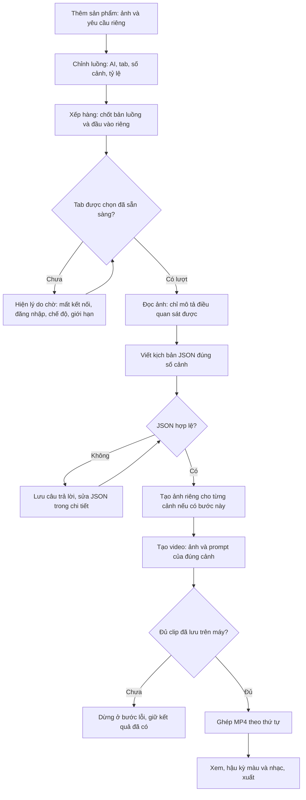

# Video hàng loạt · MooZ 0.55.0

Bản này chỉnh ứng dụng thật trong `desktop/batch/`. Cài Workflow Connect **1.6.0**, bấm **Tải lại** trong `chrome://extensions`, rồi tải lại các tab Muse đang mở. Chỉ thay ZIP không cập nhật bộ nối đã nằm trong tab cũ.



## Đầu vào và chỉnh sửa

- Mỗi sản phẩm có 1–8 ảnh khi xếp hàng. Nút **×** trên từng ảnh gỡ tham chiếu khỏi sản phẩm, không xóa tệp dùng chung trong Kho media. Có thể gỡ hết khi còn nháp; phải thêm lại ít nhất một ảnh trước khi chạy.
- Sản phẩm đã xếp hàng chốt ảnh, tên, yêu cầu và phiên bản luồng. Nếu chưa bắt đầu lần xử lý nào, dùng **Rút về nháp để sửa ảnh**, chỉnh và xếp lại. Sau khi đã bắt đầu, không âm thầm thay đầu vào của tác vụ cũ.
- Luồng phải có Tạo video và Ghép thành phẩm ở cuối. Phân tích/kịch bản đặt trước tạo ảnh/video. Từ hai cảnh trở lên phải có Viết kịch bản; luồng một cảnh có thể đi trực tiếp Ảnh → Tạo video → Ghép.
- Mỗi bước chọn AI và có thể chỉ định một tab cụ thể. Tab đó vẫn phải được chọn trong Nhóm tab AI. Không tự chuyển sang tab khác khi tab được chỉ định đóng.

## Kịch bản và kết quả

Trong **Chỉnh luồng → Cấu trúc kịch bản & quy tắc chạy** có JSON mẫu và quy tắc app gửi AI. Mỗi cảnh gồm:

```json
{
  "scenes": [
    {
      "scene": 1,
      "title": "Tên cảnh",
      "voiceover": "Lời thoại",
      "imagePrompt": "Yêu cầu tạo ảnh tĩnh",
      "videoPrompt": "Yêu cầu chuyển động của cảnh",
      "duration": null,
      "size": "9:16"
    }
  ]
}
```

Phải đủ đúng số cảnh đã chốt, số cảnh liên tiếp từ 1, không trùng; lời thoại và prompt không được trống. JSON sai dừng trước các lượt tạo ảnh/video. Chi tiết sản phẩm giữ nguyên câu trả lời để sửa, bấm **Kiểm tra JSON & dùng kịch bản**, sau đó chạy hàng chờ. Bước viết không bị gửi lại khi đã chấp nhận kịch bản sửa hợp lệ.

Bước tạo ảnh chỉ nhận `imagePrompt` của cảnh hiện tại; bước video nhận `videoPrompt` và lời thoại của cảnh đó. Không gửi cả kịch bản có prompt video vào lượt tạo ảnh. Có bước tạo ảnh thì video dùng ảnh cảnh đã tạo; bỏ bước ảnh thì dùng ảnh gốc của sản phẩm. Lời thoại là chỉ dẫn cho AI, chưa phải bảo đảm giọng đọc/lip-sync hoặc track âm thanh được tạo riêng.

**Không chọn** thời lượng: không thêm yêu cầu số giây vào lượt tạo video. Thời lượng thực tế do AI quyết định. Ghép chỉ hoàn tất khi đủ tệp clip đã lưu, không lấy URL bìa/thumbnail làm video.

## Tab AI và hàng chờ

**Cập nhật tab AI** kiểm tra bộ nối, phiên đăng nhập, ô chat, trạng thái bận và phiên bản hỗ trợ chạy nền. Mở được một tab không đồng nghĩa tab đã sẵn sàng. Thẻ trạm AI có lý do và nút **Mở tab** để kiểm tra thủ công.

Hàng chờ ghi rõ thiếu tab đã chọn, mất kết nối, cần cập nhật/tải lại tab, chế độ Ảnh/Video không khớp, tab đang bận hoặc đang tạm dừng. Giới hạn gửi AI chung của ứng dụng cũng hiện ở đây: mặc định một tác vụ/nhà cung cấp, nhịp gửi 5 giây. Có bốn tab không tự động nâng hạn mức này. Chỉ thay hạn mức trong cài đặt điều phối khi phù hợp với dịch vụ.

Nếu dịch vụ đã ngắt kết nối/yêu cầu xác minh/giới hạn lượt, kiểm tra trực tiếp trước rồi dùng nút tiếp tục. Cập nhật danh sách tab không tự xóa chặn của dịch vụ. App không gửi lại prompt khi mất phản hồi sau khi gửi.

## Muse trả video vào node ảnh

Bộ nối kiểm tra lựa chọn Ảnh/Video được xác nhận trong ô chat trước khi gửi. Nếu thấy Video nhưng bước cần ảnh, dừng trước thao tác gửi và hướng dẫn đổi chế độ. Nếu không đọc được lựa chọn rõ ràng, app không đoán hoặc tự bấm nút không xác định; prompt vẫn nêu rõ cần ảnh tĩnh.

Nếu Muse thực sự trả video cho yêu cầu ảnh, app báo sai loại, giữ video trên tab và không dùng ảnh bìa video thay ảnh. Nếu phản hồi có cả ảnh hợp lệ và video, chỉ nhận ảnh mới thuộc đúng lượt. Kiểm tra kết quả cũ trước khi chủ động chạy lại.

## Chạy nền qua relay và giới hạn kiểm chứng

Bộ nối không yêu cầu phần tử có layout rect để đọc ô chat và phản hồi CSS-visible; phần bị ẩn rõ ràng vẫn bị loại. Theo dõi thay đổi DOM, nhịp kiểm tra từ extension và hỏi trạng thái tác vụ từ app tiếp tục đánh thức bộ thu kết quả. Không tự giành tiêu điểm tab, không gửi prompt lần hai để thử đánh thức.

Nếu chính trang Muse ngừng tạo/render kết quả khi tab bị ẩn, hoặc Chrome/máy ảo bị ngủ/đóng/discard, bộ nối không thể bảo đảm làm trang tiếp tục chạy. Dùng **Mở tab** để kiểm tra. Khi hết hạn chờ, app chỉ báo chưa nhận kết quả, không tự tạo lại.

Kiểm thử dùng Electron thật, Chrome và extension thật, relay TLS cục bộ và dữ liệu trang AI mô phỏng. Tab Muse không được chọn; fixture phục hồi giá trị visibility nền vì Playwright mặc định ép mọi trang có focus/visible, đồng thời mô phỏng layout rect rỗng. Đã kiểm tra không tự chuyển tab, không gửi trùng khi sai loại, và nhận đúng ảnh qua relay. Đây chưa phải kiểm chứng trên tài khoản Muse và máy ảo Muse thực tế của người dùng.
