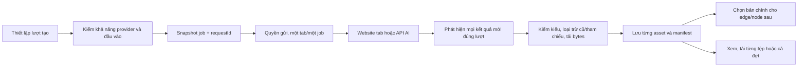
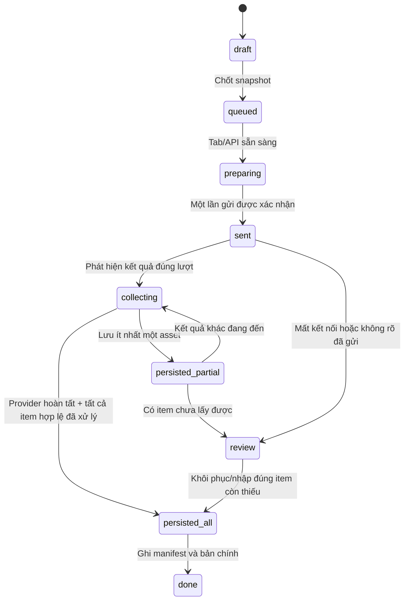
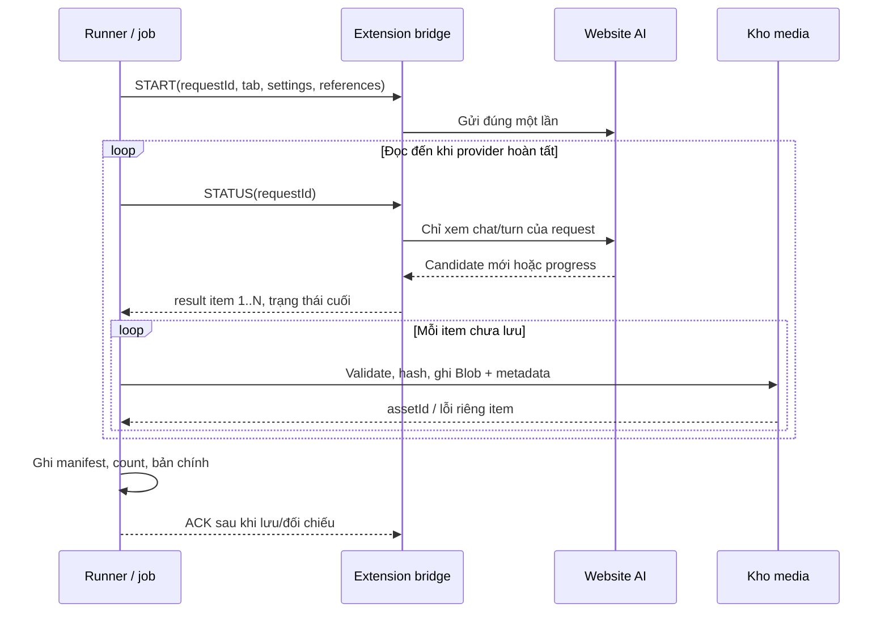
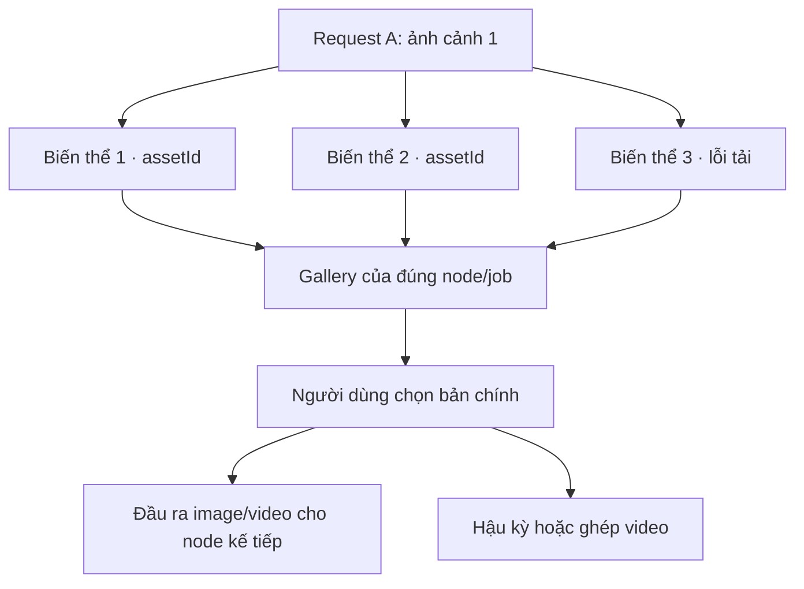

# Hướng dẫn lập trình: cài đặt lượt tạo và ghi nhận toàn bộ kết quả AI

**Phạm vi:** ứng dụng desktop Electron trong repo `mktminhqpbga-glitch/app-mooz`, đối chiếu mã ngày 06/11/2026. Đây là tài liệu triển khai cho đối tác, **không phải tuyên bố mọi tính năng dưới đây đã có**. Đặc biệt, “lấy toàn bộ kết quả” nghĩa là lấy **mọi đầu ra hợp lệ thuộc đúng một lượt gửi/tác vụ**, không quét tất cả ảnh/video trên mọi chat hoặc vượt quyền của website AI. Không quy định bố cục, màu sắc hay vị trí nút; giao diện phải theo hệ thống thiết kế chung của app.

## 1. Mục tiêu và giới hạn hiện tại

Một lượt tạo ảnh có thể trả 1–4 ảnh; một lượt video có thể trả clip, poster, preview và nhiều biến thể. App cần lưu **tất cả tệp đầu ra hợp lệ của đúng lượt** thành các asset riêng, giữ thứ tự/nguồn gốc, cho người dùng chọn bản chính để nối sang node sau và tải từng tệp hoặc tải cả đợt. Poster video không phải clip; ảnh tham chiếu được website hiển thị lại không phải ảnh mới. Nếu trang AI không cho tải một tệp, ghi trạng thái **đã thấy nhưng chưa lấy được**, tuyệt đối không đánh dấu đã lưu toàn bộ.

Mã hiện tại có nền tảng `requestId`, baseline DOM, xác minh chat, điều phối gửi, kho media và checkpoint. Nhưng một số nhánh còn nhận **một** kết quả: `muse-bridge.js` chọn `best` và trả một `url`; `ai-providers.js` dùng `find(...)`, `generatedSamples?.[0]`, `data?.[0]`; Canvas `app.js` dùng `node.data.asset`; Video hàng loạt dùng `items[]` cho **nhiều cảnh**, không tự đồng nghĩa nhiều biến thể trong **cùng một cảnh**. Vì vậy, nếu yêu cầu “lấy toàn bộ”, cần đổi contract từ scalar sang collection xuyên suốt extension → transport/API → runner → storage → UI; chỉ sửa gallery ở cuối không đủ.



## 2. Giao thức: phân biệt lớp gửi, lớp kết quả và lớp lưu

### 2.1 Website AI qua MooZ Connect

App nói chuyện với extension qua WebSocket local `ws://127.0.0.1:<cổng>` hoặc WSS remote qua relay. Mã `workflow-connect://...` chỉ ghép app và extension, **không gọi model**. Lệnh tạo đi tới đúng tab đã gán; content script thao tác composer/attachment của website. `desktop/ai-dispatch.cjs` cấp lượt theo `register → prepare → permit → sent → finish`: chuẩn bị trước khi tải tham chiếu, xin quyền ngay trước khi bấm Gửi. Mặc định cách gửi 5 giây, cooldown 5 giây và 1 tác vụ hoạt động/provider; mỗi tab chỉ một job. Chỉ tăng giới hạn khi đã xác nhận provider/tài khoản cho phép. Với luồng video hàng loạt, **một luồng = một AI, một tab đã gán qua mọi bước AI**, tab bận thì queue chờ, không tự chuyển giữa chừng.

`requestId` là mã lượt do app tạo **trước khi gửi**; `jobId`, `nodeId`, `stepId`, `sceneIndex` là mã xử lý của app. Với Muse, `MUSEFLOW_JOB_START` có thể bấm gửi; `MUSEFLOW_JOB_STATUS` đọc cùng lượt; `MUSEFLOW_JOB_ACK` dọn trạng thái tab. `response-ack` chỉ xác nhận app đã nhận thông điệp từ extension. Không ACK nào thay thế được xác nhận **đã ghi bytes vào kho media**. Khi socket ngắt ngắn, giữ response để resume; nếu đã `sent` mà trạng thái không rõ, đối chiếu tab trước, không phát lại `START`.

### 2.2 API AI trực tiếp

App gửi HTTPS request có key và schema theo provider, nhận JSON/operation rồi tải file. Adapter phải biết provider trả **một hay nhiều** item và cách xác định operation đã hoàn tất. Google/Veo có operation thăm dò; fal có status/response URL; OpenAI ảnh có `data[]`. Không dùng parser chung chỉ lấy `[0]`. Key và URL tải có xác thực không được in vào log; chỉ tải từ host/URL hợp lệ theo adapter, chặn redirect nguy hiểm. HTTP 429 dùng `Retry-After` và hold; POST đã gửi mà timeout **không** tự phát lại.

### 2.3 Ba xác nhận tách biệt

| Mốc | Chứng minh điều gì | Chưa chứng minh điều gì |
| --- | --- | --- |
| `sent` | Tab/API đã nhận thao tác gửi, có request ID. | Provider đã tạo xong hoặc app có file. |
| `observed/validated` | Có output mới đúng lượt, đúng loại, tải/giải mã được. | File đã nằm an toàn trong kho và job đã cập nhật. |
| `persisted` | Bytes + metadata + mapping request/asset đã ghi thành công. | Người dùng đã chọn bản chính hoặc đã xuất hậu kỳ. |



`persisted_partial` không được đổi thành `done` chỉ vì ảnh đầu tiên xuất hiện. Kết thúc khi provider báo hoàn tất/không còn streaming **và** bộ thu đã quét ổn định các item mới, hoặc khi một adapter API trả danh sách có số lượng xác định. Nếu không có tín hiệu hoàn tất đáng tin, đặt cửa sổ chờ yên ổn hữu hạn và lưu trạng thái `partial/review` thay vì khẳng định “đủ”.

## 3. Các lựa chọn cài đặt lượt tạo phải hoạt động thật

Mỗi lựa chọn cần ba thứ: (1) giá trị người dùng chọn; (2) quy tắc/giới hạn theo provider/model; (3) **giá trị đã gửi và giá trị thực nhận**. Không ghi “4K”, “chất lượng cao” hoặc “4 ảnh” như một cam kết nếu website chỉ nhận câu prompt hoặc adapter chỉ gửi một request cho một ảnh.

| Lựa chọn | Dữ liệu nên lưu | Áp dụng ở đâu | Xác minh sau tạo |
| --- | --- | --- | --- |
| Provider/kênh/tab | `provider`, `transport`, `deviceId`, `tabId`, `conversationIdentity` | Chọn một lần cho job/luồng; API không cần tab | Đúng tab/chat/model đã chọn, không nhận từ chat khác. |
| Model | `requestedModel`, `effectiveModel` khi xác định được | API truyền model trong request; tab website dùng model đang chọn ở trang | Không giả vờ app đã đổi model website nếu không có bridge kiểm chứng. |
| Tỷ lệ khung | `aspectRatio` như `1:1`, `16:9`, `9:16`, `4:3`, `3:4` theo loại/provider | API dùng field `size/aspectRatio` nếu hỗ trợ; tab có thể chỉ dùng prompt hoặc chọn trên trang | Ghi `actualWidth/actualHeight`, tỷ lệ thực, cảnh báo lệch. |
| Độ phân giải | `resolution` hoặc pixel đích hợp lệ | Chỉ gửi khi API/model hỗ trợ hoặc xuất local; không coi upscale là chi tiết AI mới | Đọc pixel thực của ảnh/video; không chỉ đọc nhãn UI. |
| Chất lượng | `quality` enum theo provider (`low/medium/high` nếu có) | API truyền đúng field hỗ trợ; tab website chỉ là yêu cầu nếu không điều khiển được | Không thể suy chất lượng thị giác từ tên mức; lưu setting và dung lượng/codec thực. |
| Số lượng | `requestedCount`, `maxCount` theo adapter | Nếu API hỗ trợ `n`, gửi trong một request; nếu tab không hỗ trợ, tạo nhiều **requestId/job con** rõ ràng | `observedCount`, `persistedCount`, `failedCount`; không tự nhân bản cùng một file. |
| Thời lượng video | `requestedDuration` hoặc `null` (không chọn) | Chỉ gửi mức provider cho phép; Google Veo adapter hiện 4/6/8 giây, các tab có bộ chọn 5/10/15/30/40 giây | Ghi `actualDuration` từ metadata; clip ngắn hơn yêu cầu cần báo. |
| Ảnh/video tham chiếu | `assetId`, `role` (`product`, `character`, `startFrame`, `motion`), thứ tự | Chỉ gửi nguồn nối đúng port; ảnh nhân vật là **tùy chọn** | Loại tệp tham chiếu khi quét result, giữ fingerprint nguồn. |
| Nền/negative prompt | Giá trị riêng có hỗ trợ | Nối vào prompt hoặc API field hợp lệ | Không tự khẳng định model đã làm đúng; người dùng đánh giá. |

**Nguồn hiện tại:** Canvas `app.js` có bộ chọn tỷ lệ ảnh `1:1/16:9/9:16/4:3/3:4`, video `16:9/9:16/1:1`, thời lượng theo provider; `ai-providers.js` có mapping API riêng. Adapter OpenAI ảnh hiện gửi `n:1` và mapping kích thước ba trường hợp; Google ảnh lấy `out.find(...)`; Veo lấy `generatedSamples[0]`. Bản desktop **chưa có hợp đồng quality/count đồng nhất xuyên mọi provider**. Nếu thêm các nút chất lượng/số lượng, phải đổi adapter, validator và storage trước khi hiển thị như tính năng đã dùng được.

**Phân biệt ba khái niệm:** tỷ lệ khung là hình dạng, độ phân giải là số pixel, chất lượng là tham số của model/codec hoặc mức chi tiết cảm nhận. `16:9` không có nghĩa `4K`; `high` không bảo đảm tỷ lệ đúng; file 4K nội suy không chứng minh model đã tạo 4K. Bản xem trước có thể giảm kích thước; bản tải cần lấy asset gốc khi được cung cấp.

### 3.1 Cấu hình khả năng provider, không hard-code một menu toàn app

Ví dụ cấu trúc **đề xuất**, không phải schema hiện có:

```js
const capabilities = {
  muse: { transport: 'tab', outputs: ['text','image','video'],
    image: { ratios: ['1:1','16:9','9:16','4:3','3:4'], countMode: 'one-request-per-variant', qualityControl: false },
    video: { ratios: ['16:9','9:16','1:1'], durations: [5,10,15,30,40] } },
  openai: { transport: 'api', outputs: ['text','image'],
    image: { countMode: 'api-field-if-model-supports', referenceImages: false } }
};
```

Đây chỉ là **mẫu kiến trúc**: giá trị thực phải lấy từ adapter và tài liệu model đang dùng, không dùng danh sách trên để tự bật mọi nút cho tài khoản hiện tại. Với tab, cần kiểm tra mode/model trên website và báo “Yêu cầu” nếu chỉ chèn vào prompt. Với API, chuẩn hóa enum ở UI rồi adapter dịch sang field đúng; nếu model từ chối, hiển thị lỗi cụ thể, không tự đổi model có thể tính phí khác.

### 3.2 Snapshot và dữ liệu kiểm toán cho mỗi request

```json
{
  "jobId": "job-uuid",
  "requestId": "request-uuid",
  "nodeId": "image-node-id",
  "sceneIndex": 1,
  "provider": "muse",
  "transport": "chrome",
  "deviceId": "chrome-device-id",
  "tabId": 123,
  "conversationIdentity": "provider-chat-or-project-id",
  "requested": {
    "kind": "image", "model": null, "aspectRatio": "16:9",
    "quality": null, "resolution": null, "count": 4,
    "references": [{"assetId":"image-id","role":"character"}]
  },
  "state": "queued"
}
```

Mẫu này để thiết kế contract; **không copy vào importer hiện tại**. Khi tab chỉ hỗ trợ một ảnh/lượt, `count:4` được tách thành bốn request ID có `variantIndex:0…3`, mỗi request giữ cùng snapshot. Khi API trả bốn file trong một request, một request ID có bốn `resultItemId` theo thứ tự provider. Giữ rõ hai dạng này để tránh đếm nhầm.

## 4. Làm sao thu được **toàn bộ** kết quả của đúng lượt?

### 4.1 Trước khi gửi: tạo ranh giới quan sát

1. Ghi URL/chat/project ID và tab/device gán cho job. Nếu trang mở chat mới khi gửi lần đầu, chỉ chấp nhận URL mới khi xác nhận được tin người dùng của chính lượt này ở đó.
2. Chụp baseline mọi item media có trong vùng **phản hồi trợ lý** trước gửi: `src`, DOM identity, message/turn ID, provider item ID nếu có, poster/video URL, kích thước, fingerprint khi lấy được. Không chụp cả trang như một gallery chung.
3. Tính fingerprint tham chiếu đã upload; giữ thứ tự và vai trò ảnh sản phẩm/nhân vật. Sau upload cần đợi website xác nhận attachment hiển thị trước khi Gửi; FileList vừa gán không đủ.
4. Lưu request vào job và trạng thái `preparing` trước thao tác có thể tính phí; `permit` trước click Gửi; ghi `sentAt` và bằng chứng website nhận tin người dùng. Nếu không biết click đã thành công hay chưa, giữ `unknown`, không gửi lại.

### 4.2 Sau gửi: tìm từng item mới và chứng minh nguồn gốc

Bridge nên theo dõi MutationObserver + kiểm tra định kỳ nhẹ khi tab nền. Chỉ xét phần tử thuộc **tin phản hồi mới hơn `sentAt`** trong **đúng chat/project**, không phải ảnh user upload, avatar, hình trang trí, quảng cáo hay tin AI cũ. Đợi phản hồi ổn định và trạng thái tạo kết thúc. Mỗi candidate có `providerMessageId`, `providerItemId` nếu trang lộ ra; nếu không, tạo `candidateKey = chat + turn + DOM path/role + normalized URL + fingerprint` và đánh dấu mức tin cậy. URL CDN có thể đổi trong cùng một ảnh; fingerprint bytes mới là dấu chống trùng mạnh hơn. Nếu không phân biệt được hai candidate, lưu dạng `needs_review`, không chọn bừa.

Video có thể lộ poster trước file media. Mở player khi cần để lấy `currentSrc` hoặc nút tải hợp lệ; nếu chỉ có MSE/preview không tải được, đừng ghi asset video. Với text, chờ hết streaming rồi gom **tất cả block** của cùng câu trả lời theo thứ tự; không ghép câu trả lời của hai tin khác nhau. Với ảnh, gom mọi ảnh mới có kích thước thực và loại avatar/thumbnail nhỏ; so fingerprint với ảnh đầu vào, kể cả khi URL đã đổi.



### 4.3 Tải file, kiểm loại, lưu và ACK

Quy trình mỗi item:

1. Lấy URL tải/file bytes trong origin có quyền (extension) hoặc endpoint API hợp lệ. Không lưu `blob:` của trang AI làm URL lâu dài; không coi thumbnail là file gốc. Trường hợp CDN cần quyền tab, tải tại extension rồi chuyển bytes về app. Không cho URL trả về tùy ý truy cập nội mạng.
2. Kiểm `Content-Type` **và** giải mã/sniff file; ảnh có `width/height > 0`, video có `width/height/duration > 0`, dung lượng trong giới hạn. Ghi MIME, byte size, hash SHA-256. So fingerprint với mọi input và asset đã nhận cùng request; loại trùng cùng output, nhưng không loại hai tệp khác nhau chỉ vì cùng tên.
3. Ghi Blob thành asset ID mới trong kho local, kiểm ghi thành công, rồi ghi mapping `requestId → resultItemId → assetId`. Cập nhật `persistedCount` theo giao dịch/idempotency. Nếu item 3/4 lỗi, giữ item 1–2 đã lưu và job `partial/review`; không xóa chúng.
4. Cập nhật Canvas/queue qua **manifest**: danh sách mọi `resultItemId/assetId`, bản được chọn `selectedAssetId`, trạng thái từng item, timestamps. Chỉ sau đó mới gửi ACK để extension có thể giải phóng response tạm. ACK thất lạc thì gửi lại được mà không tạo asset mới.
5. Đường nối của graph dùng **bản chính đã chọn** hoặc quy tắc fan-out rõ (ví dụ “mỗi biến thể thành một nhánh”). Không âm thầm đưa cả bốn ảnh vào một port chỉ nhận một ảnh. Với nhiều cảnh, dùng hai chỉ số riêng `sceneIndex` và `variantIndex`.

**Vấn đề bộ nhớ:** base64 của file 100 MB có thể thành khoảng 133 MB trước overhead JSON. Không giữ toàn bộ video lớn của nhiều request trong RAM/Chrome storage. Một triển khai sản phẩm nên truyền theo chunk/stream có thứ tự, hash từng phần và quota, ghi asset sớm rồi giải phóng buffer; relay hiện có giới hạn thông điệp JSON 128 MB nên phải tuân giới hạn thực và không hứa hỗ trợ video lớn hơn nếu chưa đổi transport. Kho local cần báo thiếu dung lượng và cho người dùng xuất/giải phóng dữ liệu.

### 4.4 Hợp đồng response/result đề xuất

```json
{
  "requestId": "request-uuid",
  "status": "complete",
  "expectedCount": 4,
  "items": [
    {
      "resultItemId": "provider-id-or-stable-derived-id-1",
      "kind": "image",
      "source": "assistant-turn",
      "providerMessageId": "message-id-if-available",
      "mime": "image/png",
      "width": 1536,
      "height": 1024,
      "sha256": "sha256-of-bytes",
      "transferState": "available"
    }
  ],
  "scanComplete": true
}
```

`expectedCount` là `null` nếu website không công bố số lượng; `scanComplete` chỉ true khi có bằng chứng provider đã kết thúc và đã quét ổn định, không suy từ “đã thấy 1 ảnh”. Payload kết quả media nên là metadata + kênh transfer có giới hạn, không nhét bốn data URL lớn vào một JSON. Trong kho, manifest tối thiểu gồm `requestId`, `jobId`, `nodeId`, `sceneIndex`, `resultItemId`, `assetId`, `status`, `error`, `observedAt`, `persistedAt`, `sourceFingerprint`, `selected`, `actualWidth/Height/Duration`, `requestedSettings`. Không log prompt, token, cookie, API key hay signed URL.

### 4.5 Pseudocode cho collector idempotent

```js
async function collectAll(request, bridge, store) {
  const seen = new Map(); // resultItemId -> assetId / trạng thái lỗi
  let complete = false;
  while (!complete) {
    const scan = await bridge.status(request.requestId); // READ ONLY, không gửi lại
    assertSameTabChatAndRequest(scan, request);
    for (const candidate of scan.items) {
      const id = stableItemId(candidate, request);
      if (seen.has(id) || await store.hasResult(request.requestId, id)) continue;
      if (isBaselineOrReference(candidate, request)) continue;
      try {
        const bytes = await bridge.download(candidate);
        const media = await validateAndHash(bytes, request.mediaType);
        const asset = await store.putAsset(media);
        await store.linkResult(request.requestId, id, asset.id);
        seen.set(id, asset.id);
      } catch (error) {
        await store.recordItemError(request.requestId, id, error);
      }
    }
    complete = scan.scanComplete === true;
    if (!complete) await waitOrYield(scan.nextPollMs);
  }
  const manifest = await store.getManifest(request.requestId);
  await store.markCompleteOrPartial(manifest);
  await bridge.ack(request.requestId); // sau khi mapping đã ghi
  return manifest;
}
```

Đây là **thuật toán mục tiêu**, không phải hàm đã có. Thực tế cần timeout/AbortSignal, backoff, giới hạn tải song song, resume cursor, trạng thái provider hold và bảo vệ khi app tắt. Nếu `status()` trả `missing` sau khi đã `sent`, đối chiếu website/lịch sử hoặc nhập file thủ công, không tạo request mới tự động.

## 5. Luồng dùng kết quả trên Canvas và hàng loạt



**Canvas đơn:** node giữ `results[]`/manifest và `selectedAssetId`; preview/edge mặc định dùng bản được chọn. Lưu graph + Blob trước khi gọi “thành công”; nếu Blob thiếu khi mở lại, báo thiếu tệp. Thay prompt/ratio/quality/reference làm kết quả cũ `stale`, vẫn có thể xem lịch sử nhưng không dùng như output mới. Nếu người dùng chọn biến thể khác, chỉ đổi selected ID và cập nhật downstream; không gọi AI lại.

**Tạo ảnh hàng loạt:** mỗi prompt/bản sao là job/request rõ ràng. Nếu một request trả nhiều ảnh, lưu tất cả biến thể của **chính request đó**; đừng gán kết quả của prompt 2 cho prompt 1 theo vị trí DOM. Bộ lọc/hàng đợi hiển thị `đã nhận X/Y`, lỗi riêng từng item, nút tải từng item/cả nhóm. Không tự tạo “bản sao” bằng cùng một asset nếu người dùng yêu cầu nhiều ảnh độc lập.

**Video hàng loạt:** `desktop/batch/flow-runner.js` đang có `job.outputs[step.id].items` theo cảnh; mở rộng thành `scenes[sceneIndex].variants[]` hoặc record tương đương. Một cảnh cần một clip để ghép: chỉ đưa **biến thể đã chọn và đã lưu** vào FFmpeg. Nếu cảnh 2 có ba clip, người dùng chọn một; ba clip vẫn nằm trong lịch sử. `resultId` của Z trỏ MP4 cuối, không trỏ poster/clip trung gian. Giữ checkpoint từng cảnh; lỗi ở cảnh cuối không khiến ba cảnh trước gửi lại. Một luồng giữ một AI/một tab, bao gồm cả khi có nhiều biến thể.

**Kho kết quả và export:** cho phép tải file gốc của từng asset với tên `job-scene-variant` ổn định; “Tải tất cả” tạo archive hoặc tải lần lượt có manifest, không bỏ qua file lỗi mà không báo. Phân biệt `providerOriginal`, `localEdited`, `thumbnail`, `poster`. Hậu kỳ nhận một asset video được chọn, không nhận `src` tạm của website.

## 6. Lộ trình sửa mã theo thứ tự phụ thuộc

1. **Định nghĩa contract và migration:** thêm `results[]`/manifest, `selectedAssetId`, item status, count vào schema job/node. Di chuyển `node.data.asset` cũ thành danh sách một item khi đọc lại; không xóa dữ liệu cũ. Đối với batch, tách `sceneIndex` và `variantIndex`.
2. **Sửa adapter API:** Google duyệt mọi `candidates/parts` ảnh hợp lệ; Veo duyệt mọi `generatedSamples`; OpenAI duyệt mọi `data[]`; fal duyệt trường video trả về theo schema model. Không đọc dữ liệu lỗi/khác loại như thành phẩm. Viết adapter capabilities cho count/quality/ratio/duration; nếu provider chỉ tạo một item, orchestrator tạo job con có request ID riêng theo giới hạn.
3. **Sửa bridge tab:** Muse/Gemini/ChatGPT/Grok/Flow trả danh sách item của đúng assistant turn, duy trì baseline, chat identity, fingerprint input và cờ `scanComplete`. Giữ trạng thái `STATUS` idempotent. Provider UI thay đổi phải báo lỗi bộ nối, không quét media toàn trang để bù.
4. **Sửa transport:** truyền manifest/result theo từng item hoặc chunk có ACK và resume; giới hạn bytes. `response-ack` sau khi app đã ghi item/mapping, không xóa response chỉ vì socket nhận JSON. Khi reconnect, trả lại item chưa ACK theo ID ổn định.
5. **Sửa storage và runner:** validate bytes, ghi asset, mapping, checkpoint riêng từng item; khôi phục request đang dở bằng `STATUS`/operation ID nếu còn, nếu không chuyển `review`. Chỉ `done` khi đủ điều kiện hoàn tất; `partial` vẫn giữ asset đã nhận.
6. **Sửa UI cài đặt/kết quả:** bộ chọn chỉ hiện khả năng thực của provider; hiển thị `requested` và `actual`, số kết quả đã lưu/tổng dự kiến, thư viện biến thể, chọn bản chính, tải từng/tất cả, lỗi từng item. Bố cục cụ thể do thiết kế chung của app quyết định.
7. **Kiểm thử với fixture rồi tài khoản thật:** mô phỏng nhiều ảnh/clip, CDN đổi URL, poster trước video, stream chưa xong, reconnect/ACK trùng, hết quota, app restart, tab đổi chat. Sau đó kiểm thử thủ công trên từng website/model thật vì DOM/quyền provider thay đổi ngoài mã app.

## 7. Bảng nghiệm thu bắt buộc

| Ca kiểm thử | Kết quả đúng |
| --- | --- |
| Provider trả 4 ảnh trong một reply | Có 4 asset riêng, đúng thứ tự/ID; count 4/4, chọn bản chính không gọi AI. |
| Cùng prompt yêu cầu 4 ảnh nhưng provider chỉ hỗ trợ 1/lượt | Orchestrator tạo 4 lượt có 4 requestId, không gán cùng file bốn lần. |
| AI hiển thị lại 2 ảnh tham chiếu và tạo 2 ảnh mới | Chỉ 2 ảnh mới vào manifest; input được loại bằng baseline/fingerprint. |
| Video có poster rồi file MP4 tải được | Chỉ MP4 thật thành asset video; poster là thumbnail riêng. |
| 3/4 item lưu được, item cuối lỗi mạng | Job `partial/review`; 3 asset còn nguyên; tiếp tục lấy item cuối không gửi prompt lại. |
| `STATUS`/response lặp sau reconnect | Mapping không nhân đôi asset; ACK an toàn. |
| Đổi chat/tab khi đang thu kết quả | Dừng nhận và báo mismatch; không nhặt media của chat khác. |
| Người dùng chọn 16:9, AI trả 1:1 | Giữ file thực, ghi pixel/tỷ lệ thực và cảnh báo; không đổi nhãn thành 16:9. |
| Chọn `high`, adapter không có quality field | Không hiện như chế độ được bảo đảm; yêu cầu hoặc chặn có giải thích. |
| Chọn 3 biến thể video ở một cảnh | Chỉ clip được chọn vào ghép; các clip còn lại tải được từ lịch sử. |
| Lưu kho thất bại sau khi preview hiện | Không `done`; báo chưa lưu an toàn và cho khôi phục. |

**Tệp mã nguồn cần mở theo thứ tự:** `ai-providers.js` (provider/API), `desktop/ai-dispatch.cjs` (quyền gửi), `muse-bridge.js` và `ai-bridge.js` (phát hiện result), `desktop/chrome-relay.cjs`/`desktop/chrome-relay-worker.js`/`chrome-relay-channel.js` (transport và ACK), `app.js` (Canvas/asset), `batch-manager.js` (queue), `desktop/batch/flow-runner.js` + `desktop/batch/app.js` (video batch/kho). Đọc thêm [hồ sơ kết nối AI và ghi nhận kết quả](PARTNER-HANDBOOK-APP-MOOZ-PART-2-AI.md) và [hướng dẫn AI, tạo hàng loạt, hậu kỳ](APP-MOOZ-AI-BATCH-VIDEO-POSTPRODUCTION.md).
