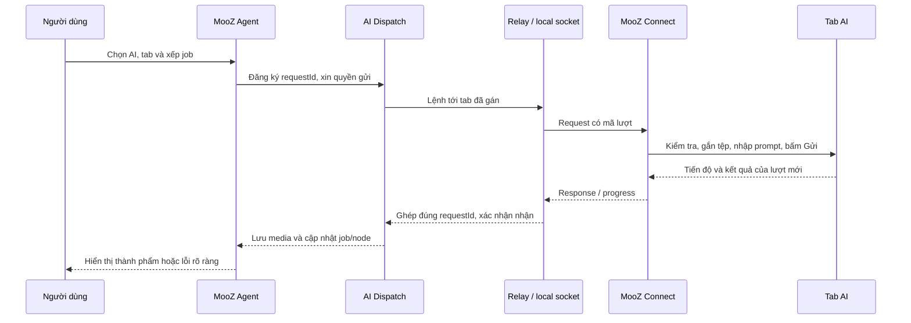

# Hồ sơ bàn giao MooZ Agent — Phần 2: Kết nối AI và nhận kết quả

**Đọc sau:** [Phần 1 — sản phẩm, Canvas Studio và kiến trúc tổng thể](PARTNER-HANDBOOK-APP-MOOZ.md).
**Phiên bản đối chiếu:** `app-mooz` 0.69.0, MooZ Connect 1.9.2, ngày 05/11/2026.
**Phạm vi:** ứng dụng desktop Electron trong repo `mktminhqpbga-glitch/app-mooz`. Đây là đặc tả cơ chế hiện có kèm các yêu cầu thiết kế cho đối tác; không phải tài liệu của website `mooz.gt.tc/workflow/`.

## 1. Cần hiểu bốn thứ tách biệt

| Thành phần | Nó làm gì | Nó không làm gì |
| --- | --- | --- |
| **MooZ Agent** | Giữ dự án, graph, job, hàng đợi, phân công tab, lưu kết quả và giao diện. | Không tự có model AI nếu chưa kết nối tab/API. |
| **MooZ Connect** | Tiện ích Chrome/Edge, nhận lệnh có xác thực, thao tác trên đúng tab AI, đọc tiến độ và kết quả. | Không chứa Canvas; không phải dịch vụ tạo ảnh/video. |
| **Relay / transport** | Chuyển thông điệp giữa app và tiện ích cùng máy hoặc qua Internet. | Không phải AI; không tự chạy tiếp job khi app tắt. |
| **Nhà cung cấp AI** | Website đã đăng nhập hoặc API có khóa, thực sự tạo văn bản/ảnh/video. | Không bảo đảm mọi model/chế độ đều hỗ trợ mọi đầu vào. |

Một kết nối transport khỏe chỉ chứng minh app và extension nói chuyện được. Để job chạy, còn cần **tab đúng website, đăng nhập, màn soạn prompt sẵn sàng, chế độ ảnh/video đúng, quyền gửi còn hiệu lực và khả năng nhận media**. Khi thiết kế bảng trạng thái, phải hiển thị từng tầng này, tránh báo “Đã kết nối” như thể AI đã sẵn sàng.



## 2. Các con đường kết nối AI hiện có

### 2.1 Tab AI trong Chrome/Edge, cùng máy

App mở WebSocket trên loopback `127.0.0.1` với cổng ngẫu nhiên, tạo token ghép. Người dùng bấm **Kết nối Chrome** trong app, sao chép mã dạng `workflow-connect://127.0.0.1:<port>/<token>` và dán vào MooZ Connect. Extension kiểm tra cú pháp mã rồi mở `ws://127.0.0.1:<port>/`. App chỉ chấp nhận origin của extension Chrome, giới hạn phiên chưa xác thực và kiểm tra token trước khi cấp lệnh. Sau auth, app trả `ready` cùng phiên bản/giao thức. **Không đưa token ghép vào log, URL website, project export hay ảnh chụp chia sẻ công khai.**

Đây là cách đơn giản nhất khi Chrome và MooZ cùng trên một máy. Local socket không cần Internet để ghép **hai chương trình**, nhưng tab AI vẫn cần Internet để dùng dịch vụ AI. App không cần port cố định; sau khi app đóng/mở hoặc thu hồi phiên, mã cũ có thể không còn dùng được. Ghép lại bằng mã đang hiển thị trong app.

### 2.2 Tab AI ở máy khác qua relay Internet

App và extension **cùng chủ động mở kết nối WSS đi ra** broker Node `relay-server/`. App tạo phòng và lời mời; mã remote dạng `workflow-connect://relay?...` chứa endpoint/room/invite/thông tin phiên cần thiết cho extension, **không phải API key của AI**. Mã chưa dùng hết hạn khoảng 10 phút; khi kết nối thành công, phiên có cơ chế resume riêng. Tạo mã mới hoặc thu hồi phòng có thể làm phiên cũ không còn hợp lệ. Cả app và máy Chrome phải truy cập được hostname relay qua HTTPS và WSS.

Kênh app ↔ extension qua broker mã hóa đầu cuối AES-256-GCM trong `chrome-relay-channel.js`; broker không có khóa để đọc prompt/media. Dữ liệu được chia khung cỡ 192 KiB, xác thực thứ tự, hướng và phiên, rồi ghép lại. Có giới hạn 128 MB cho **thông điệp JSON**; base64 và mã hóa làm lưu lượng lớn hơn tệp gốc. Broker hiện giữ phòng trong RAM, một instance; restart/sleep/redeploy có thể mất phòng. Đây là transport cá nhân, **không phải job queue bền vững**. Xem `docs/OUTBOUND-RELAY.md` để triển khai và `docs/REMOTE-CHROME.md` cho các lựa chọn remote khác.

Kiểm tra theo thứ tự: (1) `https://<relay>/health` trả đúng service; (2) extension mở được WebSocket; (3) vào phòng; (4) app xác thực; (5) tab AI sẵn sàng. HTTPS 200 **không** chứng minh WebSocket hay phòng đã ghép. Diagnostic của MooZ Connect phân biệt `opening_socket`, `joining_relay`, `authenticating_app`, `connected`.

### 2.3 Cửa sổ AI tích hợp và nhiều Chrome

Một số tác vụ có thể dùng cửa sổ AI do app mở thay cho tab Chrome. `desktop/ai-windows.cjs` xử lý đường native; `desktop/posting-ai.cjs` và các caller chuẩn hóa `transport: native/chrome/api`. Trang AI có thể chặn đăng nhập trong cửa sổ tích hợp; khi đó dùng Chrome + extension, không cố vượt cơ chế xác minh của dịch vụ.

App còn có **Nhóm thiết bị Chrome** (`desktop/chrome-devices.cjs`): mỗi thiết bị có transport độc lập; ID tab được ánh xạ thành ID ảo để các máy không đụng nhau. Job đã gán máy/tab nào giữ đúng danh tính đó. Mất máy A không tự chuyển job sang tab có cùng số ID trên máy B. Danh sách thiết bị và route cần làm mới sau thay đổi kết nối.

### 2.4 API AI

Có hai nhóm API cần phân biệt:

1. **Adapter tích hợp trong dự án** (`ai-providers.js`): Google Gemini/Veo, OpenAI và fal.ai tùy loại đầu ra/đầu vào. Khóa được người dùng cấu hình trong thiết lập AI. Adapter phải kiểm tra giới hạn thực của model: ví dụ Veo video có giới hạn duration và chỉ một ảnh bắt đầu trong adapter hiện tại; fal Motion Control cần đúng một ảnh nhân vật và một video nguồn. Có endpoint có thể thay đổi/ngừng cấp quyền; không cam kết API key bất kỳ là chạy được.
2. **Kết nối API tùy chỉnh** (`desktop/ai-connections.cjs`): endpoint HTTPS chuẩn **OpenAI Chat Completions** (`/chat/completions`) cho **văn bản**; có thể đọc ảnh nếu model hỗ trợ `image_url` và bật vision. Nhóm này **không sinh ảnh/video đầu ra**, không gửi video tham chiếu. URL/model/tên được lưu trong `ai-connections.json`; khóa chỉ giữ trong bộ nhớ phiên app, phải nhập lại khi mở app. Đổi base URL cần nhập lại khóa. Giới hạn 30 kết nối tùy chỉnh; URL phải là domain HTTPS công khai hợp lệ, không chứa token/query/fragment. API POST chặn redirect. HTTP 429 tạm dừng theo `Retry-After` hoặc mặc định; không phát lại POST vừa thất bại nếu trạng thái không chắc.

**Không dùng tên “API AI” chung chung trong báo giá.** Đối tác phải ghi rõ provider, endpoint, auth, loại media, input, output, model, hạn mức, chi phí và cách xử lý timeout/429. Đường API khác tab browser: không cần Chrome nhưng vẫn phải có khóa, quyền model và mạng hoạt động.

## 3. Danh mục provider và khả năng

Danh mục trong `ai-providers.js` khai báo năng lực **bộ nối**; nó không xác nhận tài khoản hiện tại có quyền dùng model hoặc tab đang ở đúng chế độ.

| Provider | Kênh | Loại khai báo | Ghi chú vận hành |
| --- | --- | --- | --- |
| Muse | Tab | Text, image, video | Cần tab/chat đã đăng nhập; kiểm tra chế độ Ảnh/Video; result gắn đúng chat/lượt. |
| ChatGPT | Tab | Text, image | Phụ thuộc UI và gói tài khoản; không suy ra có video. |
| Gemini | Tab | Text, image | Kết quả và ảnh cần kiểm tra media thật. |
| Grok | Tab | Text, image, video | Chọn đúng Chat/Imagine/chế độ trong trang. |
| Google Flow/Veo | Tab | Image, video | Mở đúng dự án/chế độ/model trên Flow; không dùng cho text trong app. |
| Google | API | Text, image, video | Model và quyền thực tế do Google cấp; adapter có validation riêng. |
| OpenAI | API | Text, image | Adapter tạo ảnh hiện không hỗ trợ ảnh tham chiếu. |
| fal.ai | API | Video | Adapter Motion Control yêu cầu một ảnh và một video tham chiếu. |
| API tùy chỉnh | API | Text, đọc ảnh tùy model | Chat Completions; không phải image/video generation. |

Để thêm provider tab mới, chỉ thêm domain vào danh sách **không đủ**. Cần allowlist URL/quyền extension, bộ dò composer, upload, gửi, nhận kết quả, kiểm thử đổi chat và version extension. Để thêm provider API mới, cần adapter tách biệt có xác thực, validation, timeout, parse kết quả, chi phí và test fixture.

## 4. Quy trình người dùng: từ cài đặt đến tác vụ đầu tiên

1. Cài MooZ Agent và MooZ Connect đi kèm **cùng gói phát hành phù hợp**. Trong Chrome `chrome://extensions`, bật Developer mode, **Load unpacked** thư mục chứa `manifest.json`. Nếu đã có bản extension cũ ở thư mục khác, tắt/gỡ bản trùng để tránh hai tiện ích cùng tranh phiên.
2. Mở app → **Cài đặt & kết nối AI** → chọn kết nối cùng máy hoặc từ xa → tạo mã ghép. Dán vào popup MooZ Connect và bấm kết nối. App phải hiển thị thiết bị/extension đã kết nối; extension phải báo xác thực app, không chỉ “đã mở socket”.
3. Mở một tab AI có trong danh mục, đăng nhập, vào đúng chat/dự án và chọn chế độ/model bằng UI dịch vụ nếu cần. Sau khi cập nhật extension, **Tải lại extension và tab AI** để bộ nối content script mới được nạp.
4. Trong app bấm **Cập nhật tab AI**. Danh sách phải hiển thị URL/provider/tab/thiết bị và sẵn sàng; không chọn một mục chỉ có tên giống AI nhưng URL không khớp allowlist.
5. Tạo một thử nghiệm nhỏ: prompt văn bản hoặc ảnh đơn giản, không dùng tệp lớn. Chọn provider tương ứng, chọn tab chạy nếu ở luồng/batch, gửi. Xem trạng thái “đã gửi” rồi kết quả thật trên tab và trong app. Thử này có thể tiêu tốn lượt AI của tài khoản.
6. Sau khi tuyến cơ bản ổn, mới chạy ảnh tham chiếu, video dài, nhiều tab hoặc luồng hàng loạt. Kiểm tra chi phí/hạn mức theo nhà cung cấp.

Nếu dùng **API tùy chỉnh**, bỏ qua bước extension/tab: thêm tên, HTTPS base URL, model và API key trong Cài đặt; thử một yêu cầu văn bản. Khi khởi động lại app, nhập lại khóa. Để tạo ảnh/video bằng API, dùng adapter tương ứng, không chọn kết nối Chat Completions rồi chờ ảnh.

## 5. Quy tắc “một luồng = một AI, một tab”

Quy tắc này áp dụng rõ cho **luồng video hàng loạt** trong MooZ. Mẫu luồng chỉ chọn **một AI** có khả năng xử lý toàn bộ bước AI. Bên ngoài canvas, tại form **Nhập đầu vào & chạy**, chọn **Tab chạy toàn bộ luồng**: một tab cụ thể hoặc **Tự chọn một tab đang trống**. Sau khi job nhận tab, từ bước AI đầu tiên qua các bước kế tiếp và hậu kỳ, cùng job giữ tab đó. Node riêng không có picker tab riêng. Những bước xử lý local không cần gọi website AI nhưng cũng không giải phóng quyền gán tab giữa chừng.

Ví dụ: tab Muse A đang chạy job 1, tab Muse B đang chạy job 2. Job 3 chọn tự động → chờ tab phù hợp rảnh. Nếu job 3 **chỉ định A** thì chờ **A**, kể cả B đang rảnh. Nếu A ngắt kết nối, job 3 vẫn chờ/đòi đối chiếu A; không chạy ở B. Hạn mức đồng thời theo provider có thể làm hai tab vẫn không gửi cùng lúc. `docs/USER-REVIEW-0650.md` là nguồn chi tiết cho quy tắc này.

Mục tiêu kỹ thuật là tránh dữ liệu của một luồng rơi vào nhiều cuộc trò chuyện, nhầm nhân vật hoặc nhận kết quả của job khác. Job phải ghi `assignedDeviceId`, `assignedTabId`/chat identity và graph/input snapshot. Khi tab bận, queue giữ job; không đánh dấu lỗi rồi tự đổi tab. Khi job dừng, chỉ nhả lease sau khi request đang gửi đã kết thúc hoặc đã được đánh dấu cần đối chiếu.

**Canvas đơn lẻ:** vẫn có thao tác chạy node/nhóm và set AI cho một nhóm trong `canvas-studio-bridge.js`. Đối tác không được suy diễn rằng mọi thao tác đơn lẻ của app có cùng chính sách pin tab với Video hàng loạt; cần giữ contract từng màn khi hợp nhất UX.

## 6. Giao thức gửi một lượt AI

### 6.1 Trước khi gửi

- Renderer/runner xác định job, node, loại đầu ra (`text/image/video`), provider, tab, prompt, tỷ lệ, thời lượng và nguồn nối. Nguồn không có dây nối hợp lệ không được tự đưa vào request.
- App kiểm tra tab thuộc đúng thiết bị đang kết nối và URL thuộc provider đã chọn. Với tab AI, nạp các bridge JS cần thiết vào đúng tab (`ai-activity.js`, `composer-controls.js`, `muse-bridge.js` hoặc `ai-bridge.js`), rồi gửi lệnh **kiểm tra phiên**. Phản hồi cần cho biết composer tồn tại, đã đăng nhập, không bận và giao thức bridge phù hợp.
- `desktop/ai-dispatch.cjs` đăng ký `requestId`, kiểm tra provider có bị tạm dừng vì xác minh/mất kết nối/429 không. Mặc định nhịp gửi là **5 giây**, nghỉ **5 giây** sau hoàn tất và tối đa **1 tác vụ đang hoạt động mỗi provider**; người dùng có thể cấu hình trong giới hạn code. Nhiều tab không tự tăng hạn mức provider.
- Bước `prepare` xin lượt **trước khi gắn tệp**. Sau upload, bridge kiểm tra thẻ tệp/preview xuất hiện trên trang và xác nhận prompt/chat chưa đổi. Bước `permit` xin phép lại ngay trước thao tác Gửi; quyền gửi có hạn ngắn. Nếu tab đã bị người dùng gửi thủ công trong lúc đợi, không bấm Gửi lần nữa.

### 6.2 Sau khi gửi

`AIDispatch` ghi trạng thái `sent` riêng với `preparing`. Bridge theo dõi phần trả lời mới sau thời điểm gửi, lọc lịch sử, ảnh tham chiếu, media trang trí và kết quả không đúng chat. Muse hỗ trợ `MUSEFLOW_JOB_START` → `MUSEFLOW_JOB_STATUS` → `MUSEFLOW_JOB_ACK` để app thăm dò cùng `requestId` mà không tạo lại prompt. Với những provider khác, app có thể dùng `WORKFLOW_AI_GENERATE`/bridge tương ứng. Progress mang `requestId` về UI.

Kết quả chỉ được chấp nhận sau validation: đúng request/tab/chat, đúng MIME/loại media, file tải được, kích thước hợp lệ. Video thumbnail/poster không phải file video. Nếu có nhiều kết quả mới không phân biệt được hoặc website chỉ cho preview, báo cần kiểm tra/nhập kết quả thủ công; không chọn ngẫu nhiên. Media đúng được lưu vào kho, gán cho node/preview và lịch sử job. Khi app nhận response từ extension, có `response-ack` để extension bỏ bản phản hồi đang giữ.

**Không có API nào bảo đảm chính xác 100% khi website AI đổi DOM.** Bộ nối website phải có fixture và thử nghiệm thật định kỳ; lỗi nhận diện composer/attachment/result cần thông báo có thể chẩn đoán.

### 6.3 Hợp đồng dữ liệu đối tác nên bảo toàn

Đây là **mô hình chuẩn hóa để thiết kế**, không phải JSON public API hiện có:

```json
{
  "jobId": "job-uuid",
  "requestId": "request-uuid",
  "projectId": "project-uuid",
  "nodeId": "node-id",
  "provider": "muse",
  "transport": "chrome",
  "deviceId": "primary",
  "tabId": 123,
  "mediaType": "image",
  "prompt": "Mô tả ảnh cần tạo",
  "references": [{"assetId": "asset-uuid", "role": "character"}],
  "status": "waiting_for_tab"
}
```

Bản ghi thực tế cần thêm graph/input snapshot, chat identity, mode, timestamps, attempt, result asset, lỗi và idempotency. **Không** lưu token ghép, cookie, khóa API hoặc data URL bí mật trong log/telemetry. Đừng copy ví dụ trên nguyên xi vào importer; đọc contract từng module khi triển khai.

## 7. Đọc, xác minh và ghi nhận kết quả AI — quy trình chi tiết

Đây là phần đối tác cần thực hiện cẩn thận nhất. **“Nhìn thấy ảnh trên website” ≠ “có file hợp lệ” ≠ “đã lưu bền vững vào dự án”.** Ba mốc phải hiển thị/ghi nhận riêng. Hai đường hiện tại là (A) Canvas Studio dùng runner trong `app.js`, và (B) Video hàng loạt dùng `desktop/batch-ai.cjs` rồi lưu trong `desktop/batch/app.js`. Chúng có cùng nguyên tắc nhưng không hoàn toàn cùng hàm.

### 7.1 Tạo căn cứ để biết kết quả nào thuộc lượt này

Trước khi bấm Gửi, bridge trong tab ghi **baseline**: URL/DOM của các ảnh, video và phản hồi đã có; nó cũng giữ vị trí lượt người dùng, chat URL và `requestId`. Sau khi bấm Gửi, chỉ xét **phản hồi trợ lý mới hơn lượt gửi** trong **cùng cuộc trò chuyện**. Nếu website tạo URL chat mới từ màn “New chat” lần đầu, bộ nối chỉ chấp nhận chuyển tiếp khi có bằng chứng chính lượt vừa gửi xuất hiện; không tự nhận một chat khác đã tồn tại.

`ai-bridge.js` cho ChatGPT/Gemini/Grok/Flow đọc “fresh replies”, loại nội dung người dùng, avatar, media baseline và output đang streaming. Văn bản cần ổn định (không còn trạng thái đang tạo) trước khi đọc. Prompt có thể có marker mở/đóng để cắt đúng câu trả lời, không lấy toàn bộ lịch sử. Với Flow, nhiều kết quả mới mà không xác định được một lựa chọn sẽ báo mơ hồ để người dùng kiểm tra, không lấy kết quả cuối tùy tiện.

`muse-bridge.js` theo dõi attachment trong vùng phản hồi hiện tại; so với baseline trước gửi và fingerprint của tệp tham chiếu đã upload. Ảnh tham chiếu có thể xuất hiện lại với URL blob/CDN **mới**; vì thế chỉ so URL là chưa đủ. Khi fingerprint trùng ảnh đầu vào, bỏ qua và tiếp tục đợi. Video được yêu cầu thì ảnh bìa/poster không phải kết quả. Khi URL chat đổi ngoài chuyển tiếp hợp lệ, dừng nhận và báo “Cuộc trò chuyện Muse đã đổi”. Dữ liệu của chat mới không được nhập vào node cũ.

**Ví dụ:** trước gửi chat có ảnh A; người dùng upload ảnh B; AI trả ảnh C. Baseline loại A, fingerprint loại B, chỉ C có thể được nhận. Nếu AI trả video V thì thumbnail của V không thay V. Nếu người dùng chuyển chat giữa chừng, kể cả chat kia có ảnh đẹp hơn, không được dùng ảnh đó.

### 7.2 Muse: giữ mã lượt để thăm dò mà không gửi lại

Với Muse, app gửi `MUSEFLOW_JOB_START` có `requestId`. Tab lưu trạng thái job trong `museJobs`; nếu cùng ID được hỏi lại, không bấm Gửi prompt lần nữa. App hỏi `MUSEFLOW_JOB_STATUS` mặc định mỗi **10 giây**, nhận `running/progress` hoặc `done/result`. Kết quả mang `requestId`; sai ID bị từ chối. Sau khi nhận kết quả, app gửi `MUSEFLOW_JOB_ACK` để tab dọn bản ghi đã hoàn tất. `STATUS` là thao tác đọc; `START` là thao tác có thể gây tính phí, nên không thay `STATUS` bằng một lần `START` mới sau timeout. Nếu tab reload và mất mã job, app báo cần đối chiếu/tải kết quả thủ công; không tự tạo ảnh/video mới.

Hai kiểu ACK khác nhau: `MUSEFLOW_JOB_ACK` xác nhận **job Muse trong tab** đã được đọc; `response-ack` xác nhận **app đã nhận thông điệp từ extension** qua WebSocket. Cả hai không tự chứng minh file đã lưu bền vững. Đối tác cần thêm mốc lưu trữ riêng vào state machine, ví dụ `received → validated → persisted → visible`.

### 7.3 Đọc theo từng loại kết quả

| Loại | Cách đọc đang có | Bắt buộc kiểm tra trước khi nhận |
| --- | --- | --- |
| Văn bản | Lấy phản hồi trợ lý mới, chờ hết streaming, gỡ marker nếu có; Muse có nhánh text riêng. | Không rỗng; đúng chat/lượt; với bước kịch bản nhiều cảnh phải parse/validate cấu trúc trước khi chuyển bước tiếp. |
| Ảnh | Tìm ảnh mới trong phản hồi hiện tại; chờ kích thước/ổn định; tải blob từ URL với quyền của tab nếu cần, đổi thành data URL. | MIME `image/*`, kích thước và nội dung đọc được; không là avatar/ảnh user/ảnh baseline/ảnh tham chiếu trùng fingerprint. |
| Video | Tìm video mới trong phản hồi hiện tại; lấy media URL thật, tải blob và thăm dò metadata video. | MIME `video/*`, dung lượng hợp lệ, độ phân giải và thời lượng > 0; poster/MSE preview/clip lịch sử không đạt. |
| Kết quả API | Parse response schema của provider cụ thể; ảnh/video API có thể trả data URL, URL tải hoặc async operation. | HTTP/status, quyền model, đúng loại output, tải được tệp, kiểm tra URL tải an toàn và metadata. |

`ai-bridge.js` kiểm tra video tải được và thăm dò bằng `<video>` để xác nhận width/height/duration; video quá 100 MB bị loại. Ảnh nhỏ/không tải được tiếp tục chờ hoặc báo lỗi. `desktop/batch-ai.cjs` cố ý yêu cầu kết quả ảnh/video là `data:image/...` hoặc `data:video/...` đã **sao chép về từ tab**, tối đa khoảng 100 MB; URL blob của trang AI và thumbnail không được coi là asset của batch. Đây là ranh giới quan trọng: `blob:` thuộc origin của tab AI, renderer MooZ không nhất thiết đọc được.

**Đường Muse Canvas có một giới hạn hiện tại:** khi bộ nối thấy attachment mới nhưng không copy được file, `muse-bridge.js` có thể trả URL nguồn kèm lỗi đọc. `app.js` kiểm tra có thể tải/đọc kích thước; ảnh không vượt 8 MB được `persistImage` cố chuyển thành data URL, nhưng nếu tải thất bại hoặc quá lớn thì giữ URL gốc. URL ngoài có thể hết hạn hoặc không dùng được sau khi mở lại. Vì vậy, hợp đồng **đề xuất cho bản sản phẩm** phải nghiêm hơn: chỉ báo “đã lưu” khi blob thực sự nằm trong kho của app; trường hợp chỉ có URL/preview phải báo “đã thấy trên AI, chưa lưu được — tải hoặc nhập thủ công”. Không nên mô tả mọi kết quả Canvas hiện nay là đã sao chép bền vững.

### 7.4 Từ phản hồi tới node Canvas: thứ tự cập nhật thực tế

1. Runner `app.js` tạo `requestId` cho node và lưu thông tin `lastGeneration` (provider, prompt, số tham chiếu). Node chuyển `running`, xóa asset/preview cũ của lần chạy mới. Nó đọc prompt/ảnh/video **chỉ qua các dây nối hợp lệ**.
2. `generateWithProvider(...)` trả `{ok,text/url,...}`. Với văn bản, cần `text` không rỗng rồi gán `node.data.text`, `status='success'`; một số bước còn parse kịch bản/biến thể trước khi đi tiếp.
3. Với ảnh/video, runner kiểm tra `ok`, loại đầu ra và URL; gọi `mediaDimensions(...)` để xác nhận file đọc được. Nếu video sai tỷ lệ yêu cầu, code hiện có thể chạy `frameFit` thêm viền giữ toàn bộ hình gốc, rồi đọc metadata lại. Sai số thời lượng yêu cầu được ghi thành thông báo chứ không giả vờ AI đã tạo đúng số giây.
4. Runner tạo `node.data.asset` với ID mới, `kind`, `url`, `name`, `sourceNodeId`, `sourceRequestId`, kích thước, tỷ lệ yêu cầu/thực và thời lượng thực. Video có thể trích `endFrame` riêng để nối tiếp cảnh; trích thất bại không được biến thành khung cuối giả.
5. Các node `preview` có dây từ node xử lý nhận **cùng asset** hoặc `endFrame` đúng cổng. `render()` cập nhật thẻ media và trạng thái. Node khác chỉ dùng được output qua edge; không quét toàn bộ gallery để “mượn” ảnh bất kỳ.
6. Runner gọi `queueWorkflowSave()` sau khi hoàn tất. Khi lưu, data/blob URL của asset, input, reference và end frame được chuyển sang Blob trong IndexedDB `museflow-media`; graph JSON ở `chrome.storage.local` giữ khóa dạng `museflow-idb:<key>`. Khi mở lại, `hydrateWorkflowMedia()` đọc Blob và tạo object URL để xem. Nếu Blob thiếu, phải báo lỗi; không âm thầm dùng thumbnail.
7. **Hiện tại UI có thể hiển thị thành công trước khi lưu chậm hoàn tất** để không khóa nút điều khiển. Nếu save lỗi, app báo “generation completed, but workflow could not be saved”. Với sản phẩm mới, đối tác nên tách trạng thái `AI xong` và `đã lưu an toàn`, chỉ đưa job vào danh sách thành phẩm bền vững sau khi lưu tệp + metadata thành công; có thể vẫn cho xem tạm với nhãn rõ.

Không gán kết quả vào node nếu node đã bị xóa, job đã dừng hoặc request ID cũ đã bị thay. Khi lỗi nhận/tải/lưu, giữ nguyên nguyên nhân cụ thể: `AI chưa trả`, `đã thấy nhưng chưa tải được`, `tệp hỏng/sai MIME`, `không lưu được`, `chat đã đổi`, `request chưa rõ`. Lỗi trước gửi và sau gửi có chính sách retry khác nhau.

### 7.5 Từ phản hồi tới Video hàng loạt: tệp và checkpoint

1. `desktop/batch-ai.cjs` giữ `workerId → requestId` cho một tab đang chạy; kiểm tra provider, session, giao thức và đầu vào. Trả văn bản đã cắt giới hạn hoặc `dataUrl` media **đã copy về**. Khi dừng, lease tab chưa được giải phóng cho việc khác cho tới khi request cũ kết thúc.
2. `desktop/batch/flow-runner.js` đọc kết quả của bước, chuyển `dataUrl → Blob`, gọi `saveResult(blob,kind,name)`. Hàm trong `desktop/batch/app.js` từ chối blob rỗng hoặc >100 MB; tạo asset ID, nguồn `result`, MIME, size, metadata ảnh/video, thời gian và object URL, rồi ghi asset xuống kho local.
3. Sau khi **lưu asset**, runner thêm ID vào `job.outputs[step.id].items`; với nhiều cảnh, mỗi cảnh một ID theo thứ tự. Bước văn bản lưu `rawText/text/rows` theo trường hợp, parse kịch bản trước khi dùng cho cảnh. `checkpoint()` được gọi trước/sau các ranh giới quan trọng; job có thể tiếp tục từ cảnh/bước chưa hoàn tất thay vì chạy lại toàn bộ.
4. Bước kết quả `Z` hoặc bước ghép có `resultId` trỏ vào asset đã lưu. Engine chỉ đánh dấu `done` khi bước cuối trả `resultId`; UI tìm asset bằng ID để hiện video/ảnh, tải tệp hoặc mở ở Kho media. Xóa thẻ job không tự xóa media đã lưu.
5. Nếu app khởi động lại giữa lúc job `running`, engine đổi job sang `error` với thông báo **kiểm tra tab AI trước khi chạy tiếp**, không tự gửi lại. Kết quả đã ghi ở các bước trước được giữ. Nếu người dùng chọn retry, engine tiếp tục phần chưa hoàn tất nhưng vẫn phải bảo vệ lượt AI đã gửi/chưa rõ.

### 7.6 Hợp đồng ghi nhận kết quả đối tác nên chốt

Một result record đủ dùng nên có: `jobId`, `stepId`, `nodeId`, `requestId`, `provider`, `deviceId`, `tabId`, `conversationIdentity`, `sentAt`, `observedAt`, `validatedAt`, `persistedAt`, `assetId`, `kind`, `mime`, `byteSize`, `width`, `height`, `duration`, `storageKey`, `sourceFingerprint`, `status`, `errorCode`. Nếu có nhiều kết quả hợp lệ, lưu danh sách theo thứ tự và chỉ chọn một kết quả mặc định theo quy tắc đã thống nhất. Đừng ghi prompt hoặc khóa bí mật vào nhật ký kỹ thuật.

**Thứ tự commit đề xuất:** nhận message → xác thực ID/chat/type → tải bytes → kiểm tra blob/metadata/fingerprint → ghi asset vào kho bằng khóa mới → kiểm tra ghi thành công → ghi mapping result→job/node và trạng thái `persisted` → cập nhật UI thành phẩm → gửi ACK dọn response tạm. Nếu bất kỳ bước nào trước `persisted` lỗi, job không được thành `done`. Nếu ACK thất lạc, xử lý response trùng theo `requestId + asset fingerprint` và trả lại asset cũ; **không tạo file/job thứ hai và không gửi prompt lại**. Đây là yêu cầu cải tiến để đối tác triển khai, không phải khẳng định toàn bộ thứ tự này đã có trong mã hiện tại.

### 7.7 Bảng ví dụ để QA đối chiếu

| Tình huống | Hành vi đúng |
| --- | --- |
| Prompt đã gửi, tab trả ảnh cũ và ảnh mới | Chỉ ảnh mới của đúng phản hồi được xét. |
| Ảnh upload tái xuất với URL CDN mới | So fingerprint, loại vì trùng đầu vào. |
| Video có poster đẹp nhưng file chưa tải được | Giữ `đang nhận/chưa lưu`, không `done`. |
| Trang trả hai kết quả Flow không phân biệt | Báo mơ hồ, người dùng chọn/nhập đúng file. |
| Lưu IndexedDB thất bại sau khi đã xem ảnh | Báo AI đã tạo nhưng **chưa lưu**, cho phép lưu lại/thủ công; không ghi thành phẩm bền vững. |
| App khởi động lại, media key thiếu Blob | Báo mất media có thể khôi phục; không hiển thị kết quả giả. |
| Response WebSocket đến hai lần sau resume | Ghép đúng ID, ghi asset một lần, ACK an toàn. |
| Đổi chat hoặc node đã bị xóa trước khi result đến | Không gán sang node/chat khác; giữ job để đối chiếu hoặc báo lỗi rõ. |

## 8. Mất kết nối, nối lại và chống gửi trùng

### 8.1 Đứt socket ngắn sau khi app/extension đã ghép

`desktop/chrome-relay.cjs` và `desktop/chrome-relay-worker.js` có cơ chế giữ request/response **tối đa khoảng 90 giây** cho các mã đóng cho phép khôi phục. Extension thử nối lại có giới hạn lần và thời gian; app chỉ nhận lại **cùng extension và cùng chế độ kết nối**, không ghép một extension khác vào yêu cầu đang chờ. Extension giữ phản hồi trong bộ nhớ cho đến khi app xác nhận `response-ack`; app gửi danh sách pending request khi resume. Nếu extension worker khởi động lại và mất phản hồi, nó báo tình trạng chưa rõ để app kiểm tra tab AI. Trong thời gian đang nối lại, **không gửi yêu cầu AI mới**.

Đây là **khôi phục phản hồi**, không phải “retry tác vụ AI”. Nếu website đã nhận prompt, gửi lại có thể tính phí lần thứ hai và trả kết quả khác. Hết 90 giây/relay mất phòng/Chrome tắt lâu, job cần đối chiếu thủ công với tab/lịch sử trước khi chạy lại. Không dùng mã ghép mới như cách tự khôi phục một job cũ.

### 8.2 Các trường hợp phải dừng và giải thích rõ

| Dấu hiệu | Có thể do | Hành động đúng |
| --- | --- | --- |
| Extension báo mã hết hạn | Mã remote chưa dùng hết 10 phút, mã cũ bị thay/thu hồi, sai đồng hồ/hạn tại app/broker | Tạo mã mới trong app **sau khi** kiểm tra job đang dở; ghép lại, không gửi lại job tự động. |
| HTTPS relay khỏe nhưng extension không vào phòng | WSS bị chặn, sai endpoint/room/invite, broker restart | Dùng chẩn đoán WSS/room/auth, xem log broker; không kết luận chỉ từ `/health`. |
| Socket mở rồi rớt | App không xác thực kịp, phiên/phòng sai, proxy/VPN hoặc broker không ổn | Xem stage/close code hai đầu; ưu tiên local khi cùng máy. |
| Tab báo chưa đăng nhập / không thấy composer | Chưa đăng nhập, đang ở trang khác, website đổi UI, extension cũ | Vào đúng chat/chế độ; reload extension và tab; kiểm tra lại trước khi gửi. |
| “Cuộc trò chuyện Muse đã đổi” | URL/chat đổi trong khi job chờ kết quả | Trở về đúng chat, kiểm tra lượt vừa gửi; không nhận media từ chat mới. |
| Mất kết nối sau khi đã gửi | Kết quả có thể vẫn đang tạo trên website | Giữ trạng thái chưa rõ, chờ resume; sau đó đối chiếu tab, không gửi trùng. |
| API HTTP 429 hoặc yêu cầu xác minh | Provider hạn mức/chặn | Hiển thị hold; người dùng xử lý trên provider rồi bấm kiểm tra/tiếp tục; không vượt chặn. |
| Chỉ thấy preview/poster video | Website chưa cho tải hoặc bridge không đọc được file | Không đánh dấu hoàn tất; hướng dẫn tải/nhập file đúng lượt thủ công. |

### 8.3 Những thông tin nên có trong báo cáo chẩn đoán

Thời điểm, app/extension version, transport, device ID không nhạy cảm, stage kết nối, close code, trạng thái tab/provider, `requestId` đã rút gọn hoặc định danh nội bộ, trạng thái “chưa gửi/đã gửi/chưa rõ”, kích thước payload và lỗi validation. **Không** chứa URL mã ghép, room/invite/key, cookie, API key, prompt nhạy cảm hoặc ảnh/video của người dùng. App đã có cơ chế báo lỗi được lọc; đối tác cần giữ nguyên chuẩn này khi mở rộng.

## 9. Bảo mật, quyền và giới hạn sản phẩm

- **Origin và allowlist:** local WebSocket chỉ chấp nhận origin extension; operation relay giới hạn `tabs.query/get/focus/script/message` và thao tác Shopee đã khai báo. Main process kiểm tra IPC caller; renderer không được Node integration trực tiếp.
- **Mã ghép và khóa:** local token/remote invite là credential tạm; API key giữ trong phiên theo từng đường kết nối. Không đưa secret vào project JSON, mẫu canvas, clipboard log hoặc diagnostic. Key AES đầu cuối không được relay đọc.
- **Tab AI:** extension có quyền với các hostname cụ thể. Chỉ script vào trang đúng provider; URL gần giống hoặc trang giả phải từ chối. Không đọc cookie/mật khẩu để chuyển vào app.
- **Tệp:** trước khi upload kiểm tra loại, kích thước, giới hạn số ảnh, nguồn media còn tồn tại và MIME thật của kết quả. Đừng lấy ảnh lịch sử hoặc poster để thay file đầu ra.
- **Tài khoản và phí:** lượt AI chịu chính sách/giá của nhà cung cấp. App không tự mua gói, vượt CAPTCHA/xác minh hoặc bảo đảm kết quả đúng chất lượng prompt. Với API, khóa/model phải do chủ tài khoản cấp và có quyền tương ứng.
- **Không suy diễn từ giao diện LibLib:** giống UI không cấp quyền dùng model, dữ liệu hay asset LibLib. Các tính năng chuyên biệt cần provider và hợp đồng riêng.

## 10. Yêu cầu kỹ thuật để đối tác xây app tương tự

1. **Registry provider:** mỗi provider khai báo loại output, input media, giới hạn, transport, URL allowlist, phương thức check/send/status/result/cancel. Cho phép tắt khả năng mà model hiện không còn cung cấp.
2. **Transport abstraction:** local, remote relay, native window, API có cùng interface gọi; status phải tách connected/authenticated/tabReady/providerReady. Không trộn logic network vào canvas card.
3. **Scheduler tập trung:** lease tab/device, hạn mức provider, cooldown/rate-limit, queue bền vững. Một job batch giữ tab từ đầu đến cuối. Cấp `requestId` trước khi gửi và ghi trạng thái gửi bền vững.
4. **Result matcher:** so khớp request, tab, chat/conversation, thời điểm, loại và dữ liệu media. Nếu mơ hồ thì dừng để người dùng chọn đúng tệp, không tự nhận đại.
5. **Recovery state machine:** phân biệt chưa gửi, đang chuẩn bị, đã gửi, có thể nhận phản hồi, chưa rõ, hoàn tất, đã dừng. Chỉ retry tự động khi chứng minh chưa phát sinh yêu cầu AI; POST/DOM click sau khi đã gửi không tự phát lại.
6. **Kho dữ liệu:** lưu media gốc, thumbnail và metadata riêng; node tham chiếu asset bằng ID ổn định. Backup/migration giữ link. Không giữ base64 lớn trong log.
7. **UX lỗi:** thông báo một câu dễ hiểu kèm nơi khắc phục; xem chẩn đoán kỹ thuật khi cần. Hàng đợi cạnh canvas hiển thị tab đang giữ, vị trí chờ, tiến độ và kết quả.
8. **Version protocol:** app/extension có version riêng; handshake kiểm tra capability/giao thức. Cập nhật extension và reload tab trước khi chẩn đoán DOM lỗi.

## 11. Kịch bản kiểm thử/nghiệm thu AI

| Mã | Kịch bản | Kết quả bắt buộc |
| --- | --- | --- |
| AI-01 | Local Chrome: ghép đúng mã, mở tab Muse đã đăng nhập | Hai phía xác thực; app liệt kê đúng tab và gửi thử một lần. |
| AI-02 | Sai token, origin không phải extension, mã remote hết hạn | Từ chối trước khi cấp operation; không lộ credential. |
| AI-03 | Relay HTTPS 200 nhưng chặn WSS | Báo lỗi WebSocket riêng; không báo “đã kết nối”. |
| AI-04 | Hai tab Muse, hai job, job thứ ba | Hai job giữ tab riêng; job thứ ba chờ theo giới hạn provider/tab. |
| AI-05 | Job chỉ định tab A đang bận, tab B rảnh | Job chờ A; không lén chuyển B. |
| AI-06 | Ngắt socket sau khi bấm Gửi, nối lại trong thời gian giữ | Cùng response được giao/ack; không bấm Gửi lần hai. |
| AI-07 | Extension worker mất phản hồi hoặc relay restart | Job “cần đối chiếu”; không tự báo thành công/thất bại hoặc retry. |
| AI-08 | Đổi chat Muse trong khi đợi video | Từ chối media chat khác; báo rõ cách kiểm tra lượt cũ. |
| AI-09 | Website trả ảnh lịch sử hoặc poster video | Không chấp nhận làm result. |
| AI-10 | API tùy chỉnh chỉ text, gọi yêu cầu image output | Từ chối trước POST; không tạo node ảnh giả. |
| AI-11 | API 429/redirect/timeout | Hold theo Retry-After, chặn redirect, không phát lại POST khi chưa rõ. |
| AI-12 | Reload app, mở lại dự án | Graph/media/job snapshot giữ đúng; khóa API phiên phải nhập lại; secret không nằm trong export. |

Kiểm thử tự động có thể dùng DOM fixture, WebSocket/TLS broker cục bộ và API mock để không tiêu phí. Nghiệm thu production vẫn phải thử có kiểm soát trên tài khoản/provider thật vì trang AI đổi UI, quyền model và giới hạn mạng không được chứng minh bởi fixture.

## 12. Tệp mã nguồn nên đọc theo thứ tự

1. `desktop/main.cjs`, `desktop/preload.cjs`: IPC, khởi tạo relay/dispatch/service và quyền.
2. `desktop/chrome-relay.cjs`, `desktop/chrome-devices.cjs`, `desktop/chrome-relay-worker.js`: ghép local, nhiều Chrome, extension worker, request/response/ack/reconnect.
3. `chrome-relay-channel.js`, `desktop/outbound-relay.cjs`, `relay-server/server.cjs`: mã hóa và broker remote.
4. `desktop/ai-dispatch.cjs`: queue/quyền gửi/cooldown/hold.
5. `ai-providers.js`, `ai-bridge.js`, `muse-bridge.js`, `muse-jobs.js`, `composer-controls.js`: capability và DOM workflow của website AI.
6. `desktop/ai-connections.cjs`, `desktop/posting-ai.cjs`: API tùy chỉnh và tuyến AI cho các màn nghiệp vụ.
7. `desktop/batch/`, `flow-studio.js`, `canvas-studio-bridge.js`: mẫu/job/tab và canvas.
8. `docs/AI-SEND-SAFETY.md`, `docs/OUTBOUND-RELAY.md`, `docs/USER-REVIEW-0650.md`, `docs/AI-CONNECTORS.md`: hành vi/giới hạn; các tài liệu lịch sử có thể dùng tên extension/version cũ, luôn đối chiếu mã hiện tại.
9. `tests/desktop-connection-recovery.test.cjs`, `tests/desktop-flow-tab-routing.test.cjs` và các smoke AI/relay: tiêu chí hồi quy.

**Bàn giao cần có:** sơ đồ kết nối, bảng capability provider, state machine job, test local/remote/API, báo cáo các tình huống mất kết nối và một demo với media thật. Chỉ dựng popup “Connected” hoặc nối được WebSocket không đủ để coi tích hợp AI hoàn thành.
