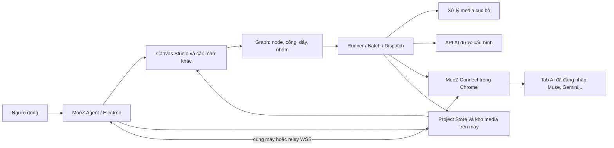

# Hồ sơ bàn giao sản phẩm và kỹ thuật — MooZ Agent / Canvas Studio

**Phiên bản đối chiếu:** mã nguồn `mktminhqpbga-glitch/app-mooz`, `package.json` phiên bản **0.69.0**, MooZ Connect **1.9.2**, ngày 05/11/2026.
**Đối tượng đọc:** đối tác sản phẩm, thiết kế, frontend, desktop, tích hợp AI, QA và vận hành.
**Phạm vi:** **ứng dụng MooZ Agent trong repo `app-mooz`**. Thư mục `liblib-canvas-web/` là website thử nghiệm riêng, **không phải app được đặc tả trong tài liệu này**. `mooz.gt.tc/workflow/` và repo `mooz-test` cũng không phải kênh phát hành ứng dụng desktop.

## 1. Tóm tắt để đối tác hiểu đúng

MooZ Agent là **ứng dụng desktop Electron** cho macOS, Windows và Linux, dùng để tạo nội dung bằng AI, tổ chức ảnh/video trên canvas, chạy luồng video hàng loạt, hậu kỳ media, quản lý dự án, soạn và đăng bài, làm nội dung affiliate. Nó đi cùng **MooZ Connect**, tiện ích Chrome/Edge giúp app điều khiển những tab AI đã đăng nhập và nhận kết quả. App hỗ trợ kết nối Chrome cùng máy hoặc qua relay WebSocket khi hai máy ở xa; một số dịch vụ có thể dùng API được cấu hình riêng.

**Canvas Studio** là bề mặt làm việc trực quan của app. Mỗi node đại diện đầu vào (ảnh/video/âm thanh/văn bản), bước xử lý hoặc kết quả. Dây nối truyền dữ liệu theo loại và quyết định phụ thuộc thực thi. Node được kéo, chọn, nhóm, sao chép, nối và chạy. UI tối giản theo ảnh tham khảo LibLib, nhưng không dùng backend, model, tín dụng hay thư viện nhân vật của LibLib. Những chức năng LibLib chuyên biệt như AI HD thật, tách lớp, xóa vật thể, panorama hoặc motion reference **không tự có chỉ vì giao diện giống**.

Điểm cần nhớ khi thuê làm app tương tự: phải làm **hai lớp song song**: (1) bề mặt canvas dễ dùng; (2) engine dữ liệu, kết nối AI, hàng đợi và lưu kết quả thật. Ảnh/video hiển thị trên node phải là media thật của dự án. Các menu không được là nút giả; nếu chưa có provider xử lý thì hiển thị giới hạn và không khẳng định đã tạo AI.

### Sơ đồ tổng thể



Mũi tên “relay” chỉ kênh chuyển dữ liệu giữa app và extension; **relay không phải AI** và không tạo ảnh/video. Cookie đăng nhập AI ở Chrome. App không tự đổi model đang chọn trên website AI nếu bộ nối không hỗ trợ điều đó.

## 2. Bản đồ sản phẩm — người dùng nhìn thấy gì

| Khu vực | Mục đích | Điểm vào / hành động chính | Dữ liệu liên quan |
| --- | --- | --- | --- |
| Trang chủ / Thư viện dự án | Tạo, mở, đổi tên, nhân bản, khôi phục dự án | Tạo dự án, mở Canvas Studio | Dự án lưu trên máy |
| Canvas Studio | Sắp xếp tài nguyên và quy trình bằng node | Thêm node, nối dây, soạn prompt, chạy bước/nhóm, xem kết quả | Graph, media, prompt, nhóm, mẫu |
| Video hàng loạt | Chạy nhiều tác vụ sản xuất video, mỗi tác vụ có dữ liệu riêng | Chọn luồng, nhập đầu vào, chọn AI/tab, xếp hàng | Mẫu luồng, job snapshot, hàng đợi |
| Đăng bài & điều hành | Soạn bài, duyệt media/caption/kênh, lập lịch, theo dõi | Chuyển kết quả đạt, tạo bản nháp, duyệt/đăng | Post drafts, assets, brand, tài khoản |
| Affiliate Shopee | Lấy dữ liệu sản phẩm và dựng kịch bản/video bán hàng | Link sản phẩm, ảnh, kịch bản, đưa sang canvas | Sản phẩm, ảnh, storyboard, job |
| Cài đặt & kết nối AI | Kết nối Chrome, tab AI, API, giao diện và báo lỗi | Cài MooZ Connect, ghép mã, kiểm tra tab | Cấu hình, trạng thái kết nối, chẩn đoán |

Các màn dùng chung desktop shell và cơ sở dữ liệu dự án; không được xây Canvas như một website cô lập nếu mục tiêu là app tương tự MooZ. Bản website tại `liblib-canvas-web/` là một hướng triển khai khác và hiện không thay thế được các service Electron.

## 3. Hướng dẫn sử dụng từ đầu đến kết quả

### 3.1 Cài và kết nối lần đầu

1. Lấy gói cài đúng hệ điều hành/kiến trúc từ GitHub Actions hoặc Release của `app-mooz`. Cài ứng dụng MooZ Agent.
2. Mở **Cài đặt & kết nối AI**. Tải tiện ích **MooZ Connect** đi kèm app, giải nén ở thư mục cố định, vào `chrome://extensions`, bật Developer mode và **Load unpacked** thư mục chứa `manifest.json`.
3. Trong app chọn **Kết nối Chrome**, tạo/sao chép mã ghép. Dán mã vào popup MooZ Connect, kết nối. Nếu cập nhật extension, bấm **Tải lại** ở trang extensions và tải lại tab AI.
4. Mở tab AI mong dùng (ví dụ Muse), đăng nhập. Quay lại app, **Cập nhật tab AI**, kiểm tra tab hiển thị sẵn sàng. Có thể dùng AI qua API nếu đã thêm khóa/endpoint tương ứng trong cài đặt.
5. Nếu Chrome chạy ở máy khác, cấu hình relay WSS hoặc cách kết nối từ xa theo `docs/OUTBOUND-RELAY.md` và `docs/REMOTE-CHROME.md`. Cả app lẫn extension phải vào đúng phòng. Mã ghép có hạn để **kết nối lần đầu**; phiên đã kết nối không cần cấp mã mới mỗi vài phút.

**Khi lỗi kết nối:** tách ba câu hỏi: HTTPS tới relay có thông không, WebSocket có mở không, hai phía có ghép/xác thực cùng phòng không. Tab AI đăng nhập và nút gửi hoạt động là bước kiểm tra tiếp theo. Nếu một lượt AI đã gửi nhưng chưa rõ kết quả, xem lại đúng tab/chat trước khi chạy lại; không tự tạo lượt trùng. Thông báo “cuộc trò chuyện đã đổi” thường là bảo vệ kết quả đúng chat, chưa đủ kết luận relay hỏng.

### 3.2 Tạo một ảnh trên Canvas Studio

1. Trang chủ → tạo hoặc mở dự án → **Canvas Studio**. Có thể thêm node **Văn bản / Prompt**, **Ảnh đầu vào**, **Tạo ảnh**, **Kết quả** từ dock hoặc menu thêm node.
2. Nếu đã có ảnh: kéo/tải ảnh từ máy vào dự án hoặc node ảnh; kiểm tra ảnh hiện trên thẻ lớn. Nếu chưa có ảnh và muốn AI sinh ảnh: tạo bước **Tạo ảnh**, nhập mô tả ở prompt editor, chọn AI đang kết nối và tỷ lệ phù hợp.
3. Nối nguồn văn bản vào cổng prompt của bước Tạo ảnh; nếu cần dùng ảnh tham chiếu, nối nguồn ảnh hoặc bảng tham chiếu vào đúng cổng loại ảnh. Dây thể hiện dữ liệu thật, không chỉ là hình trang trí.
4. Bấm **Chạy bước** hoặc nút gửi trong prompt editor. Theo dõi trạng thái tại node/hàng đợi. Khi AI trả ảnh, preview kết quả hiển thị trên canvas; mở lớn, tải về, lưu vào media hoặc dùng làm nguồn của bước tiếp theo.
5. Từ ảnh đã có, dùng menu ngữ cảnh hoặc thanh công cụ để **Tạo ảnh tiếp**, **Tạo video**, **Chỉnh ảnh cục bộ**, nhân bản, tải, nhóm hoặc xóa. Chỉ công cụ có bộ xử lý/provider thật mới được báo hoàn tất.

**Lưu ý về “node ảnh rỗng”:** ảnh mẫu người dùng cung cấp cho thấy một khung ảnh lớn, bên dưới là prompt editor và hai lối hành động **Tải ảnh lên / Tạo bằng AI**. Trong MooZ desktop 0.69.0, các thao tác này được thực hiện qua node ảnh/tài nguyên, node tạo ảnh, dock và prompt editor; **không nên mô tả bản desktop hiện tại là đã có chính xác một node hợp nhất giống pixel ảnh LibLib**. Nếu đối tác thiết kế lại, có thể hợp nhất luồng thao tác ở UI nhưng phải giữ graph, ID và dữ liệu bên dưới tương thích.

### 3.3 Tạo video từ ảnh, prompt và nhân vật

1. Chuẩn bị ảnh sản phẩm/cảnh và ảnh nhân vật tham chiếu (nếu có). Media có thể nhập từ máy hoặc kho; tên node và ảnh thumbnail cần phản ánh nội dung thật.
2. Tạo bước **Tạo video**. Nối prompt/kịch bản, ảnh cảnh và ảnh nhân vật tới cổng tương ứng. Kiểm tra loại đầu vào; cổng sai kiểu phải bị từ chối.
3. Chọn AI hỗ trợ video. Chọn tab đang đăng nhập cho **cả luồng/tác vụ** ở bước chạy hoặc dùng chế độ tự chọn tab trống. Model thực tế theo tab AI; app không chọn model chi tiết thay người dùng trong website AI.
4. Xếp hàng và theo dõi. Tab bận thì job chờ. Khi video về, preview trong canvas, tải clip hoặc đưa vào các bước ghép/hậu kỳ.
5. Với nhiều cảnh, duyệt kịch bản và thời lượng từng cảnh; mỗi cảnh được gắn đúng ảnh/prompt của mình. Đầu ra cuối ghép clip, có thể thêm nhạc/lời đọc theo tính năng có sẵn. Xem `docs/USER-REVIEW-0620.md` và tài liệu Video hàng loạt để phân biệt template với job đã chốt.

### 3.4 Công cụ canvas hằng ngày

- **Chọn node:** bấm thẻ. Chọn nhiều node để chạy/nhóm/nhân bản. Thanh ngữ cảnh chỉ hiện công cụ phù hợp với loại và số node đã chọn.
- **Pan / zoom / fit:** di chuyển vùng nhìn, phóng/thu và vừa khung; tọa độ canvas là dữ liệu của node, không làm thay đổi thứ tự chạy.
- **Nối dây:** nối cổng ra sang cổng vào có loại tương thích; một số cổng cho nhiều nguồn, một số chỉ cho một nguồn. Không cho vòng lặp gây phụ thuộc vô hạn.
- **Thiết lập node:** prompt, AI, tỷ lệ, thời lượng và nguồn tham chiếu; editor nổi ưu tiên diện tích cho nội dung. Thay prompt là sửa bản thiết kế; tác vụ đã chốt giữ đầu vào cũ.
- **Menu ngữ cảnh:** thao tác trên node/media thật: mở, tải, sao chép, nhân bản, dán, chỉnh ảnh, tạo bước nối tiếp, nhóm, xóa. Ẩn hoặc vô hiệu hóa mục không áp dụng.
- **Tài nguyên:** media trong dự án, kho prompt, nhân vật cá nhân và mẫu luồng; có thể gắn lại vào canvas. Mẫu luồng giữ cấu trúc/thiết lập, loại kết quả cũ và thông tin phiên.
- **Hàng đợi cạnh canvas:** xem tác vụ thật đang chạy/chờ/lỗi/hoàn tất. Dừng tác vụ không được biến một phản hồi muộn thành kết quả của job mới.
- **Lưu và xuất:** lưu dự án, xuất/nhập workflow JSON khi cần chia sẻ hoặc sao lưu. Không xuất khóa API, cookie, mã ghép hoặc trạng thái phiên trong workflow/mẫu.

## 4. Quy tắc nghiệp vụ quan trọng

### 4.1 Graph là dữ liệu nguồn, UI là hình chiếu

Một dự án chứa danh sách `nodes`, `edges`, `groups` và các thiết lập viewport. Node có ID ổn định, loại, tọa độ, `data`, cổng input/output. Edge có source/target và tên cổng. Render layer đổi giao diện thẻ nhưng không được âm thầm đổi loại cổng, ID, đường dẫn media hay thứ tự phụ thuộc. `canvas-studio-bridge.js` cung cấp `snapshot()`, `action(...)`, `add(...)`, `connect(...)`, `select(...)`, `subscribe(...)` để lớp UI thao tác với graph cũ. `canvas-studio.js` xây shell/dock/inspector/queue; `canvas-node-cards.css` và `canvas-studio.css` định hình giao diện.

Ví dụ minh họa **khái niệm**, không phải định dạng import hoàn chỉnh:

```json
{
  "nodes": [
    {"id":"prompt-1","type":"prompt","x":100,"y":100,"data":{"text":"Người mẫu đứng trong studio"}},
    {"id":"image-1","type":"generateImage","x":500,"y":100,"data":{"provider":"muse","size":"16:9"}},
    {"id":"preview-1","type":"preview","x":900,"y":100,"data":{"expectedKind":"image"}}
  ],
  "edges": [
    {"source":"prompt-1","sourcePort":"text","target":"image-1","targetPort":"prompt"},
    {"source":"image-1","sourcePort":"image","target":"preview-1","targetPort":"media"}
  ]
}
```

Định dạng thực phải theo contract trong mã nguồn; ví dụ trên chỉ để người đọc hiểu “nút” và “dây”. Đừng tạo importer dựa nguyên ví dụ này.

### 4.2 Một luồng = một AI và một tab chạy

Với luồng video hàng loạt hiện tại: mẫu chọn **một AI** hỗ trợ mọi bước AI của luồng. Tại form **Nhập đầu vào & chạy** ở ngoài canvas, chọn **một tab** cho toàn tác vụ, hoặc tự chọn một tab trống trong nhóm tab AI. Mọi bước AI của cùng job giữ tab đó; node riêng không chọn tab khác. Tab bận vẫn có thể được chọn và job chờ **đúng tab đó**. Nếu có hai tab, có thể chạy hai job độc lập; job thứ ba chờ tới khi tài nguyên phù hợp rảnh và hạn mức cho phép. Khi mất kết nối, không tự đổi sang tab khác hoặc tự gửi lại tác vụ chưa rõ kết quả. Xem `docs/USER-REVIEW-0650.md`.

Canvas Studio cũng có thao tác áp dụng AI cho toàn nhóm node trong `canvas-studio-bridge.js`; đối tác phải đối chiếu chính xác phạm vi của từng màn trước khi gom logic. Không biến quy tắc batch thành một claim rằng mọi nút đơn lẻ trong app đều dùng cùng một tab toàn cục.

### 4.3 Hàng đợi, phiên bản và kết quả

Luồng mẫu là **bản thiết kế có thể sửa**. Khi xếp job, app tạo bản chốt graph/đầu vào/tab cho job; sửa mẫu sau đó không thay job đã xếp. Engine chỉ đọc nguồn được nối. Job chờ khi thiếu tab, chạy khi lease hợp lệ, giữ trạng thái và kết quả theo ID. Mất mạng/tắt app có thể để lại trạng thái chưa rõ: phải đối chiếu lịch sử/tab trước khi retry. Không được nhận hình/video từ chat khác hoặc tin nhắn cũ để đánh dấu job thành công. Khi result đúng lượt đến, lưu media, cập nhật node/preview và cho phép tải/đưa sang bước tiếp theo.

**Trạng thái hiển thị đề xuất:** `chờ tab → chuẩn bị → đã gửi / đang đợi AI → nhận kết quả → hậu kỳ → hoàn tất`; nhánh lỗi nêu rõ “chưa gửi”, “đã gửi nhưng chưa rõ”, “tab/chat đổi”, “mất kết nối”, “media lỗi”. Đây là **đề xuất UX** để đối tác triển khai rõ ràng hơn; tên trạng thái nội bộ có thể khác.

## 5. Kiến trúc kỹ thuật trong repo `app-mooz`

| Thành phần | Tệp/nhóm tệp cần đọc | Vai trò và điểm sửa |
| --- | --- | --- |
| Cấu hình/bản phát hành | `package.json`, `.github/workflows/desktop.yml`, `docs/PACKAGING.md` | Electron 45, scripts test/build, electron-builder, đóng gói |
| Electron main và IPC | `desktop/main.cjs`, `desktop/preload.cjs` | Tạo cửa sổ, giao thức `workflow://app`, `workflow:call`, service, bảo vệ điều hướng |
| Project persistence | `desktop/project-store.cjs`, `desktop/workspace.cjs` | Lưu/đọc/khôi phục dự án dưới `userData`; ghi nguyên tử và kiểm tra tệp |
| Graph và runner chính | `app.js`, `app.html`, `workflow-runtime.js`, `workflow-tools.js`, `canvas-diagram.js` | Node/cổng/dây, thực thi, media và thao tác nền |
| Canvas Studio UI/adapter | `canvas-studio.js`, `canvas-studio-bridge.js`, `canvas-studio.css`, `canvas-node-cards.css`, `canvas-context-menu.js`, `canvas-prompt-editor.js` | Shell giống canvas, snapshot, action, node card, menu, prompt editor |
| Tài nguyên sáng tạo | `canvas-characters.js`, `canvas-image-editor.js`, `canvas-presets.js`, `canvas-layout.js` | Kho nhân vật, chỉnh ảnh local, mẫu luồng, bố cục |
| Video hàng loạt | `desktop/batch/`, `batch-manager.js`, `flow-studio.js`, `desktop/batch-ai.cjs`, `desktop/ai-dispatch.cjs` | Mẫu, form đầu vào, queue, điều phối AI/tab |
| Kết nối Chrome | `manifest.json`, `background.js`, `chrome-relay-channel.js`, `desktop/chrome-relay.cjs`, `desktop/chrome-devices.cjs`, `desktop/remote-chrome.cjs`, `relay-server/` | Extension MooZ Connect, kênh local/remote, broker WSS |
| AI provider và nhận kết quả | `ai-providers.js`, `ai-bridge.js`, `muse-bridge.js`, `desktop/posting-ai.cjs`, `desktop/ai-connections.cjs` | Khả năng từng AI, DOM bridge, API tùy chọn, gắn result đúng lượt |
| Các màn khác | `desktop/home.*`, `desktop/posting.*`, `desktop/affiliate.*`, `desktop/connect.*` | Trang chủ, đăng bài, affiliate, kết nối/cài đặt |
| Kiểm thử | `tests/desktop-canvas-*.cjs`, `tests/desktop-flow-*.cjs`, `tests/desktop-connection-*.cjs`, `tests/*.test.mjs` | Contract graph, smoke Electron, queue, relay, hồi phục |

**Cần đọc mã trước khi sửa:** `app.js` lớn và có nhiều chức năng cũ. Canvas Studio là một lớp bridge/presentation trên engine đó, không phải engine thứ hai. Có hai sản phẩm khác nhau trong repo: app desktop và website thử nghiệm `liblib-canvas-web/`. Đừng import state của website vào desktop hoặc triển khai desktop bằng cơ chế cập nhật `mooz.gt.tc`.

### 5.1 Vòng đời cửa sổ và quyền

`desktop/main.cjs` tạo các BrowserWindow cho trang chủ, dự án canvas, batch, posting và affiliate. `desktop/preload.cjs` chỉ mở API có kiểm soát (`workflowDesktop.call` và sự kiện). Main process xác minh caller và xử lý service; renderer không có Node integration trực tiếp. Asset cục bộ được phục vụ bằng giao thức `workflow://app`. Dự án và dịch vụ media sống dưới thư mục `userData` của Electron. Cần giữ `contextIsolation`, sandbox, kiểm tra URL ngoài và validation IPC khi chỉnh kiến trúc; không đưa `fs`/token trực tiếp vào JS giao diện.

### 5.2 Lưu trữ và media

`ProjectStore` tạo thư mục dự án theo UUID, ghi JSON qua tệp tạm rồi rename để tránh bản nửa chừng; có kiểm tra cấu trúc, dung lượng và cơ chế khôi phục. Renderer có kho media IndexedDB `museflow-media` cho asset. Các service batch/posting/affiliate có lưu riêng dưới `userData`. Vì vậy khi clone app, cần **migration dữ liệu và phiên bản**, không chỉ copy CSS/HTML. Media có thể là data URL, blob, đường dẫn nội bộ hoặc tệp asset; việc xuất/mẫu/nhân bản phải xử lý đúng vòng đời URL và dữ liệu gốc.

Không khẳng định dữ liệu tự đồng bộ giữa máy: mặc định là dữ liệu cục bộ. Sao lưu cần bao gồm dự án và media liên quan; một file JSON workflow đơn lẻ có thể không đủ để khôi phục tất cả tệp lớn nếu không nhúng chúng.

### 5.3 Gửi AI bằng tab và relay

App gửi lệnh qua AI dispatch → Chrome relay/extension → tab website AI đã đăng nhập; extension thao tác theo bridge của provider và trả tiến độ/kết quả. Kết nối local có thể dùng kênh cùng máy; remote dùng WSS broker `relay-server`. Broker chuyển tiếp payload đã mã hóa, không phải nơi lưu tác vụ hay xử lý AI. Mất mạng không được đồng nghĩa “chưa gửi”; chỉ retry sau khi biết trạng thái lượt trên tab. Extension và app có **version riêng**; sự tương thích phải đánh giá theo giao thức, không so một con số version chung.

### 5.4 Node, preview và nhúng ảnh/video

Trong Canvas Studio, bước `generateImage`/`generateVideo` có thể sinh node `preview` nối từ output media. Bước xử lý giữ cấu hình, thẻ preview giữ chỗ cho kết quả. Điều này tạo bố cục rõ “nguồn → xử lý → thành phẩm”, giúp người dùng dùng tiếp kết quả bằng dây nối. Nếu thiết kế giao diện mới theo mẫu **khung ảnh rỗng + prompt ngay dưới**, có thể trình bày hai node như một cụm trực quan, nhưng phải tránh xóa/nhập nhằng node xử lý và node kết quả ở dữ liệu nền. Upload ảnh từ máy là nguồn media; AI generation là job bất đồng bộ; hai thao tác cùng hiện trong một UI không có nghĩa cùng một execution path.

## 6. Phạm vi chức năng thật so với LibLib và bản website

| Khả năng | MooZ desktop 0.69.0 | Điều kiện hoặc phần chưa có |
| --- | --- | --- |
| Canvas node, dây kiểu dữ liệu, pan/zoom, nhóm, menu | Có; dựa trên graph và UI mới | Phải giữ dữ liệu dự án cũ khi thiết kế lại |
| Ảnh/video lớn trên canvas, preview kết quả | Có | Chỉ báo hoàn tất khi media thật nhận/lưu được |
| Tải media từ máy, kho media, prompt, nhân vật cá nhân | Có | Kho nhân vật cá nhân cục bộ; không phải thư viện LibLib chính thức |
| Tạo ảnh/video qua tab AI đã đăng nhập | Có qua provider được hỗ trợ | Phụ thuộc website AI, tài khoản, model/chế độ và kết nối tab |
| Ghép clip, một số chỉnh video/ảnh cục bộ | Có | Xử lý trên máy, phụ thuộc tài nguyên máy |
| Một luồng dùng một tab, queue khi tab bận | Có ở luồng video hàng loạt | Không đổi tab tự động khi mất kết nối |
| AI HD thật, tách lớp, xóa vật thể, panorama, motion reference chuyên biệt | Chưa có tương đương tổng quát | Chỉ làm được khi tích hợp model/API/thuật toán có khả năng đó |
| “Ảnh trống” hợp nhất như ảnh LibLib | Có các hành động thành phần, **không cam kết trùng UI từng pixel** | Có thể triển khai thành một interaction mới trên nền graph cũ |
| Website `mooz.gt.tc/workflow/` | Sản phẩm web riêng | Không phát hành hay cập nhật app desktop |

Không sử dụng logo, tên model độc quyền, ảnh mẫu, nhân vật chính thức hoặc nội dung có bản quyền của LibLib trong bản thương mại trừ khi có giấy phép. Tham khảo **mẫu tương tác và bố cục**, không tuyên bố tương thích dịch vụ LibLib.

## 7. Hướng triển khai app tương tự — yêu cầu giao đối tác

### 7.1 Nguyên tắc thiết kế

- Màn chính là canvas tối, nền chấm rất nhẹ; media là trọng tâm. Node ảnh/video tỷ lệ tự nhiên, tên và độ phân giải nhỏ phía trên. Node rỗng có hành động rõ: tải tệp hoặc tạo AI. Prompt editor ở gần node, không che ảnh; trên màn hẹp có thể thành ngăn nổi hoặc drawer.
- Toolbar trên chỉ chứa điều hướng và thao tác chọn đang cần; dock dưới cho thêm node, tài nguyên, queue, zoom. Cài đặt nâng cao và hướng dẫn dài mở theo yêu cầu, tránh chữ thừa trong bề mặt làm việc.
- Trạng thái job có thứ bậc màu và chữ; lỗi phải có hành động khắc phục. Kết quả AI không xuất hiện trong node khác hoặc chat khác. Ảnh trống, đang tạo, lỗi, hoàn tất phải có thiết kế riêng.
- Trên màn desktop hẹp, các nút thu gọn theo icon có tooltip/aria-label. Keyboard, focus và menu phải dùng được; không để prompt hoặc menu phủ nút chạy.

### 7.2 Tách lớp để dễ bảo trì

Đối tác nên giữ hoặc tái cấu trúc theo ranh giới: `GraphModel` (node/cổng/dây, validation, topo), `ProjectRepository` (lưu/migration/media), `CanvasRenderer` (viewport/SVG/thẻ), `CommandController` (undo/redo, chọn/nhóm), `JobScheduler` (queue, lease tab), `ProviderAdapter` (Muse/Gemini/API), `ResultAssociation` (request ID/chat/session), `MediaPipeline` (ảnh/video local), `DesktopShell` (IPC/windows/updater). Có thể thay UI từng phần mà không viết lại engine cùng lúc. Mọi lệnh thao tác phải đi qua cùng graph command layer để undo/redo và autosave thống nhất.

### 7.3 Hợp đồng tác vụ đề xuất (không phải API hiện có)

Nếu xây lại thành sản phẩm đa thiết bị hoặc thêm backend, nên chuẩn hóa job: `jobId`, `projectId`, `flowSnapshot`, `inputSnapshot`, `provider`, `tabAssignment`, `createdAt`, `status`, `attempt`, `requestId`, `chatIdentity`, `resultAssets`, `error`, `idempotencyKey`. Mỗi lần gửi provider cần request ID; kết quả chỉ chấp nhận khi khớp job/request/tab/chat và định dạng media. Trạng thái gửi và nhận được ghi bền vững **trước/sau** thao tác gây hiệu ứng để sau crash biết có thể retry an toàn hay phải đối chiếu. Endpoint nếu có backend mới là phần **đề xuất**, không phải URL đã sẵn trong MooZ desktop.

### 7.4 Việc ưu tiên để app chạy trơn tru

1. **P0 — đúng và an toàn:** giữ dữ liệu cũ, tách job snapshot, ghép đúng kết quả, không gửi trùng khi mất mạng, pin tab cho luồng, upload/preview thật, thông báo lỗi rõ.
2. **P1 — UX:** node ảnh trống gọn như tham khảo; prompt editor ngay dưới/neo cạnh media; queue ở cạnh canvas; menu ngữ cảnh đầy đủ thao tác thật; phím tắt/focus/zoom/pan mượt.
3. **P2 — mở rộng:** provider API mới, những công cụ AI chuyên biệt có backend thật, đồng bộ đa máy, quản lý quyền/team và telemetry có sự đồng ý của người dùng.

## 8. Chạy, kiểm thử và phát hành đúng sản phẩm

**Phát triển local:** cần Node.js phù hợp `package.json` (>=22.12), `npm ci`, `npm start` để mở Electron. `npm test` chạy unit/contract. `npm run test:studio` kiểm tra các luồng Canvas Studio bằng Electron; `npm run test:reliability` cho một số luồng cốt lõi. Một số smoke cần Chromium/Playwright/FFmpeg; đọc README và log test cụ thể. Bộ fixture không dùng AI trả phí; trước phát hành cần thử thêm bằng tài khoản/đường truyền thật trên môi trường được phép.

**Đóng gói:** `npm run package:desktop` tạo thư mục app thử; `npm run dist:mac`, `dist:linux`, `electron-builder --win` theo cấu hình và OS build. GitHub Actions `desktop.yml` tạo artifact Mac/Windows. Tăng version bằng `npm run version:app -- X.Y.Z`, chạy kiểm thử, commit/push. Có thể tạo draft GitHub Release, kiểm tra artifact rồi **publish** để người dùng thấy bản mới trong app. Bản macOS chưa ký có thể yêu cầu người dùng xác nhận mở và chỉ dẫn tới tải gói mới; không tự cài như bản signed. Xem `docs/PACKAGING.md`, `docs/AUTO-UPDATE.md`.

**Không nhầm cơ chế cập nhật:** bấm “Cập nhật” ở `mooz.gt.tc/workflow/` cập nhật **website**. Bản desktop phải build/release từ `app-mooz`; thay code trong `liblib-canvas-web/` không thay gói MooZ Agent đang cài.

### Bộ tiêu chí nghiệm thu tối thiểu

1. Tạo dự án, nhập ảnh từ máy, nhìn thấy ảnh đúng kích thước và tên; lưu, tắt/mở lại không mất graph/media.
2. Từ prompt tạo ảnh bằng provider thử, job vào queue, trả kết quả đúng node preview; có thể mở/tải và nối sang bước video.
3. Nối cổng sai kiểu hoặc tạo vòng lặp bị từ chối với lý do hiểu được. Nhân bản/nhóm/xóa/undo/redo không làm đứt dây ngoài ý muốn.
4. Hai job dùng hai tab độc lập; job thứ ba chờ. Job đã gán tab A không chạy sang tab B khi A bận hoặc mất kết nối.
5. Ngắt WebSocket sau khi gửi nhưng trước khi nhận: app không gửi lại tự động; sau nối lại chỉ nhận đúng request/chat, giữ trạng thái đối chiếu nếu chưa chắc.
6. Chọn tab Muse nhưng đổi chat giữa lúc chờ: không lấy ảnh/video của chat khác làm kết quả; thông báo cách xử lý và giữ dữ liệu job.
7. Chạy một luồng ảnh → video → ghép; kết quả là media thật có thể tải, không chỉ thumbnail hoặc URL trang trí.
8. Chuyển kết quả đạt sang Đăng bài vẫn giữ file/caption/kênh; không đăng thật nếu chưa được người dùng duyệt và cấu hình đầy đủ.
9. Test màn 640 px và desktop rộng; prompt không che media hoặc nút chạy; keyboard và tooltip dùng được.
10. Nâng cấp từ dữ liệu mẫu của phiên bản trước; có sao lưu/rollback nếu migration thất bại. Không làm lộ token, cookie, mã ghép trong export/log.

## 9. Câu hỏi cần chốt với đối tác trước khi ký phạm vi

- Đối tác **sửa trực tiếp app-mooz** hay xây ứng dụng mới? Nếu xây mới, nhập dữ liệu dự án/media/mẫu luồng cũ bằng cách nào?
- Hệ điều hành ưu tiên và cấu hình máy tối thiểu là gì? Có cần Windows, macOS Intel/ARM, Linux từ đợt đầu không?
- AI nào được cấp quyền kết nối: tiếp tục tab Muse/Gemini hiện có, API chính thức, hay provider khác? Ai sở hữu tài khoản, hạn mức và chi phí?
- Hình/clip cần chất lượng nào, thời gian chờ chấp nhận được, giới hạn kích thước, số job đồng thời và chính sách lỗi/retry?
- Có cần đồng bộ cloud/team không? Nếu có, nơi lưu media, mã hóa, phân quyền, sao lưu và xóa dữ liệu phải được đặc tả riêng.
- Có cần các tính năng LibLib chuyên biệt nào **thật** ở đợt một? Mỗi tính năng cần nêu provider/thuật toán, input/output, phí và test nghiệm thu.
- Muốn dùng ảnh tham khảo như định hướng thiết kế hay giống pixel? Chốt bộ nhận diện MooZ riêng và quyền sử dụng asset.
- Ai phát hành GitHub Release, quản lý mã ký app, tiện ích Chrome, relay và hỗ trợ khi provider đổi giao diện?

## 10. Tài liệu và thứ tự đọc đề xuất cho đội triển khai

1. Tài liệu này — phạm vi, cách dùng, quy tắc và nghiệm thu.
2. `README.md` (đọc phần phiên bản đầu; lịch sử dài phía sau để tra cứu), `docs/USER-REVIEW-0690.md` — hiện trạng UI toàn app.
3. `docs/CANVAS-STUDIO-CAPABILITIES.md`, `docs/USER-REVIEW-0650.md`, `docs/USER-REVIEW-0620.md` — giới hạn LibLib, một luồng một tab, graph batch.
4. `desktop/main.cjs` + `desktop/preload.cjs` + `desktop/project-store.cjs` — shell, IPC, persistence.
5. `app.js`, `canvas-studio-bridge.js`, `canvas-studio.js`, các CSS và module media — graph và lớp UI.
6. `desktop/ai-dispatch.cjs`, `desktop/chrome-relay.cjs`, `chrome-relay-channel.js`, `relay-server/README.md`, `docs/OUTBOUND-RELAY.md` — gửi việc và kết nối.
7. `tests/desktop-canvas-studio-smoke.cjs`, `tests/desktop-flow-tab-routing.test.cjs`, `tests/desktop-connection-recovery.test.cjs` — hành vi cần giữ.
8. `docs/PACKAGING.md`, `.github/workflows/desktop.yml` — build/phát hành.

**Nguyên tắc bàn giao:** đối tác phải đưa bản demo chạy được từ repo `app-mooz`, sơ đồ dữ liệu/luồng, các giới hạn provider, bảng kiểm thử có kết quả và hướng dẫn cập nhật app. Bản web độc lập hoặc một mockup canvas đẹp không đủ để nghiệm thu ứng dụng MooZ desktop.
